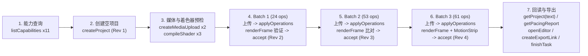

# Enterprise Agent Workflows (0–3s) — Motionade MCP 完整原语与写入记录

本文档完整还原我们是如何通过 `motionade_motionade` MCP Server 从零构建出最终项目 **`proj_b311c192-f801-4d32-af87-1b029d6e8aa1`**（Revision `4`，`1280×720`，`30 fps`，`90 frames = 3.0s`）的。

> [!TIP]
> **逐字节完整的原始 JSON 载荷（138 条操作 / 187.8 KB）** 已合并保存在本地：[all_accepted_operations.json](../examples/glean-reference/all_accepted_operations.json)。下文除给出 MCP 调用链路、全部 16 种原语的真实 JSON 结构、完整 SkSL 源码、138 条逐条清单外，还完整收录了 Revision 4 的 **110 行无删减 Text-View 原语 DSL**（完整记录了 38 个对象、3 个矢量蒙版、67 个动画块的每一个数值与关键帧）。

---

## 1. MCP 调用全链路总览（共 81 次 MCP 调用）

在 Motionade 中，项目并不是靠每次微调发一条散装 RPC 写出来的，而是采用 **“预检编译 + 批量上传 `ProjectOperation[]` + 暂存预览渲染 + 校验后正式 `acceptOperations` 提交”** 的事务式原语工作流：



### 1.1 MCP 工具调用频次统计（共 81 次）

| 阶段 | MCP 工具名 | 次数 | 作用说明 |
| :--- | :--- | ---: | :--- |
| 协议与能力查询 | `listCapabilities` | 11 | 查询支持的 Action 目录、字体（`Geist`）、Path/VectorNetwork 规范、SkSL Shader 编写规范与示例 |
| 项目初始化与读取 | `createProject` | 1 | 创建 `1280×720 @ 30fps` 空项目（返回 `projectId`、`sceneId`，Revision `1`） |
| 项目初始化与读取 | `getProject` | 2 | 初始化读取（Rev 1）+ 最终 `format: "text"` 完整原语回读（Rev 4） |
| 项目初始化与读取 | `getSceneAuthoringContext` | 1 | 获取场景当前结构与编排上下文 |
| 媒体与 Shader 预检 | `createMediaUpload` | 2 | 申请签名 URL 上传 `ref_audio_3s.wav`（44.1 kHz 立体声 3000 ms）并轮询至 `ready` |
| 媒体与 Shader 预检 | `compileShader` | 3 | 编译校验自定义 SkSL 着色器（迭代 v1 → v2，最终随 Batch 1 写入 v3） |
| 事务式原语写入 | `createOperationsUpload` | 8 | 为 `batch1_ops.json` / `batch2_ops.json` / `batch3_ops.json`（含迭代修订）申请上传通道并通过 HTTP PUT 上传 JSON |
| 事务式原语写入 | `applyOperations` | 8 | 将已上传的 `operationsRef` 暂存（stage）到项目中用于渲染预览（未修改主版本） |
| 事务式原语写入 | `acceptOperations` | 3 | 经视觉比对无误后，将 3 个批次正式提交，推动项目版本 `Rev 1 → 2 → 3 → 4` |
| 视觉验证与诊断 | `renderFrame` | 34 | 在暂存态按单帧渲染 PNG，并与原视频参考帧逐帧比对 |
| 视觉验证与诊断 | `renderMotionStrip` | 3 | 生成 `onionSkin`（洋葱皮轨迹）与 `contactSheet`（接触印相表）检验运动曲线 |
| 视觉验证与诊断 | `previewRange` | 1 | 局部帧段预览 |
| 视觉验证与诊断 | `getPacingReport` | 1 | 检查最终节奏、密度与运动曲线健康度 |
| 交付与收尾 | `openEditor` | 1 | 生成 Studio 编辑器直达链接（定位到 frame 45） |
| 交付与收尾 | `createExportLink` | 1 | 生成 `delivery` 品质导出链接供 `motionade export` 渲染最终 MP4 |
| 交付与收尾 | `finishTask` | 1 | 标记最终交付完成 |

### 1.2 写入主时间线（仅列出改变项目状态的关键调用）

1. **`createProject`（Rev 1）**：`{ name: "Enterprise Agent Workflows (0-3s Reconstruction)", format: { width: 1280, height: 720, fps: 30 } }`
2. **`createMediaUpload`**：上传本地提取的 3 秒无损音轨 `ref_audio_3s.wav` → 获得 `asset_fb0d59bc-5d7c-4578-99d9-5645a8cbeb6d`
3. **`compileShader`**：预检编译 3D 投影菱形柱丝带 SkSL（`scope: "objectFill"`）
4. **Batch 1 提交（`Rev 1 → Rev 2`，24 ops）**：
   - `createOperationsUpload` + `applyOperations`（经 1 次迭代修正 v2→v3 去掉 `max(zMax, 0.0)` 截断缺口）
   - `acceptOperations({ name: "Add scene setup, audio, lime ribbon and kinetic typography" })`
5. **Batch 2 提交（`Rev 2 → Rev 3`，53 ops）**：
   - `createOperationsUpload` + `applyOperations`（经 1 次迭代微调中景公转角度与前景景深轨迹）
   - `acceptOperations({ name: "Add midground orbit ring and foreground bokeh depth layers" })`
6. **Batch 3 提交（`Rev 3 → Rev 4`，61 ops）**：
   - `createOperationsUpload` + `applyOperations`（经 3 次迭代消除隐藏引导路径默认描边、修正三角形重心与 `Follow Path` 贝塞尔缓动）
   - `acceptOperations({ name: "Add Glean logo spiral assembly with dynamic vector masks" })`

---

## 2. 138 条 `ProjectOperation` 原语统计

最终被正式提交（Accepted）进项目的原语一共 **138 条**，涵盖 **16 种** Motionade 原生 `ProjectOperation` 类型，共同构成了 Scene 1 中的 **38 个对象、1 个音频轨、1 个自定义 SkSL 着色器、3 条矢量蒙版绑定、67 个动画块**：

| # | 原语 `kind` | Batch 1 | Batch 2 | Batch 3 | 合计 | 用途说明 |
| :-: | :--- | ---: | ---: | ---: | ---: | :--- |
| 1 | `updateSceneName` | 1 | 0 | 0 | **1** | 设置场景标题 |
| 2 | `updateSceneDuration` | 1 | 0 | 0 | **1** | 设置总时长 `90` 帧（3.0s @ 30fps） |
| 3 | `setSceneBackgroundFill` | 1 | 0 | 0 | **1** | 设置暖米白纯色画布背景 `#F7F2EB` |
| 4 | `addAsset` | 1 | 0 | 0 | **1** | 注册已上传的 3 秒 WAV 音频资产 |
| 5 | `addAudioClip` | 1 | 0 | 0 | **1** | 将音频资产挂载到场景时间轴 `f0..f90` |
| 6 | `addObject` | 6 | 15 | 7 | **28** | 创建 5 个容器 `frame`、3 个 `text`、20 个基础 `shape`（矩形/圆角矩形/椭圆） |
| 7 | `addVectorNetwork` | 0 | 4 | 6 | **10** | 创建 7 个带顶点 `cornerRadius` 的圆角等边三角形 + 3 条 C1 平滑三次贝塞尔运动引导曲线 |
| 8 | `addShader` | 1 | 0 | 0 | **1** | 在 `#central_lime_ribbon` 上挂载自定义 SkSL `objectFill` 着色器，并暴露 6 个 Studio 可调参数 |
| 9 | `keyShaderProperty` | 4 | 0 | 0 | **4** | 为着色器的 4 个动态参数（`spinAngle` / `pillarSize` / `baseHalfGap` / `fadeHeight`）写入关键帧 |
| 10 | `materializeActionFacets` | 8 | 34 | 15 | **57** | 创建原生关键帧动画块（`layerBlur` / `opacity` / `move` / `letterSpacing` / `rotation` / `scale`） |
| 11 | `addFollowPath` | 0 | 0 | 9 | **9** | 将 Logo 组装的 9 个图层（含同步蒙版克隆层）绑定到 3 条隐形贝塞尔引导曲线上 |
| 12 | `updateMotionSegmentTiming` | 0 | 0 | 9 | **9** | 为 9 个 `Follow Path` 块的 `progress` 轨道设置精确 `cubicBezier` 缓动曲线 |
| 13 | `updateObjectBase` | 0 | 0 | 6 | **6** | 将 3 条引导路径设为 `opacity: 0` 隐藏；为 3 个英雄三角形设置质心 `originX: 0.5, originY: 0.62, rotation: -10` |
| 14 | `setObjectLayer` | 0 | 0 | 3 | **3** | 设定 3 个 `VectorNetwork` 英雄三角形的精确渲染层序（`z=2, 7, 9`） |
| 15 | `setObjectRange` | 0 | 0 | 3 | **3** | 设定 3 个英雄三角形的生命周期（`f79..f90`） |
| 16 | `addMaskBinding` | 0 | 0 | 3 | **3** | 绑定 3 组原生 `vector` 矢量蒙版，实现“圆内变色 + 方/三角交集蓝色 XOR 透镜” |
| | **合计** | **24** | **53** | **61** | **138** | — |

---

## 3. 四大核心原语架构设计

1. **父子容器级联（`Frame` Parenting）**
   - `#intro_world` 包裹前半段所有视觉元素（丝带、公转环、三行大字、前景散景），只需给这一个容器加 2 条动画（`#act_intro_blur` 失焦模糊 + `#act_intro_fade_out` 淡出），就能让整个开场世界同步散焦退场。
   - `#midground_orbit_ring`（原点 `originX=0.5, originY=0.5`）用单条 13 关键帧脉冲旋转动画带动 7 个中景图形整体顺时针公转；各子图形只需在局部坐标系做“径向呼吸”位移（蓝色大球再叠加一条 `-360°` 反向自转以维持球体高光方向恒定）。
2. **参数化自定义 SkSL 着色器（`addShader` + `keyShaderProperty`）**
   - 中央旋转的青柠色 V 字形折面丝带并非预渲染视频，而是由 74 行 SkSL 实时计算旋转方柱的正面深度轮廓 `zFront`，再按 `innerHalf = max(3.0, p_baseHalfGap - p_chevronSlope * zFront)` 生成上下对称的沙漏状丝带与柔和羽化渐变。6 个参数全部作为 Studio 滑块/拾色器暴露，后续在 Studio 中可直接拖动修改。
3. **隐形贝塞尔引导路径 + `Follow Path`（零逐帧关键帧冗余）**
   - 后半段 Glean Logo 汇聚（f70–f89）没有堆砌逐帧 `(x, y)` 关键帧，而是先用 `addVectorNetwork` 画出 3 条带 `tangentStart`/`tangentEnd` 的 C1 平滑曲线（`#guide_hero_circle`、`#guide_hero_square`、`#guide_hero_triangle`）并隐藏，再用 `addFollowPath` + `updateMotionSegmentTiming` 以 **2 关键帧 + 1 条三次贝塞尔缓动** 驱动整个螺旋入场。
4. **纯原生 `vector` 蒙版实现动态变色与 XOR 蓝色交叠**
   - `#glean_logo_assembly` 内按严格 z-order 叠放 9 个图层 + 3 条 `addMaskBinding(mode: "vector")`：
     - 底层（蓝圆外部）：`#hero_out_sq`（暖橘方, z=1）+ `#hero_out_tri`（薄荷绿三角, z=2）
     - 中层：`#hero_blue_circle`（品牌蓝 `#333CEE` 主圆, z=3）
     - 蓝圆内部变色层：`#hero_in_sq`（亮青柠方, z=5）被与蓝圆完全同步运动的 `#hero_blue_mask_sq`（z=4）矢量裁切；`#hero_in_tri`（翠绿三角, z=7）被同步蓝圆 `#hero_blue_mask_tri`（z=6）裁切
     - 顶层 XOR 交集透镜：`#hero_xor_tri`（纯蓝 `#333CEE` 三角, z=9）被与方块完全同步运动的 `#hero_mask_sq_xor`（z=8）裁切，自然产生方形与三角形相交处的蓝色挖空/反色透镜效果。

---

## 4. 完整自定义 SkSL 着色器源码（`glean_chevron_ribbon_v3`）

挂载于 `#central_lime_ribbon`（`scope: "objectFill"`, `placementId: "fill_chevron_ribbon"`）：

```glsl
uniform float4 ms_contentRect;
uniform float ms_dpr;
uniform float p_spinAngle;
uniform float p_pillarSize;
uniform float p_baseHalfGap;
uniform float p_chevronSlope;
uniform float p_fadeHeight;
uniform float4 p_limeColor;

float2 frontProfile(float x, float S, float theta) {
  float R = S * 0.70710678;
  float a0 = theta + 0.78539816;
  float a1 = theta + 2.35619449;
  float a2 = theta + 3.92699082;
  float a3 = theta + 5.49778714;
  float2 v0 = float2(R * sin(a0), R * cos(a0));
  float2 v1 = float2(R * sin(a1), R * cos(a1));
  float2 v2 = float2(R * sin(a2), R * cos(a2));
  float2 v3 = float2(R * sin(a3), R * cos(a3));

  float xMin = min(min(v0.x, v1.x), min(v2.x, v3.x));
  float xMax = max(max(v0.x, v1.x), max(v2.x, v3.x));
  float insideX = min(x - xMin, xMax - x);

  float zMax = -1e6;
  float xc = clamp(x, xMin, xMax);
  float lo0 = min(v0.x, v1.x); float hi0 = max(v0.x, v1.x);
  if (hi0 - lo0 > 0.001 && xc >= lo0 - 0.001 && xc <= hi0 + 0.001) {
    float t = clamp((xc - v0.x) / (v1.x - v0.x), 0.0, 1.0);
    zMax = max(zMax, mix(v0.y, v1.y, t));
  }
  float lo1 = min(v1.x, v2.x); float hi1 = max(v1.x, v2.x);
  if (hi1 - lo1 > 0.001 && xc >= lo1 - 0.001 && xc <= hi1 + 0.001) {
    float t = clamp((xc - v1.x) / (v2.x - v1.x), 0.0, 1.0);
    zMax = max(zMax, mix(v1.y, v2.y, t));
  }
  float lo2 = min(v2.x, v3.x); float hi2 = max(v2.x, v3.x);
  if (hi2 - lo2 > 0.001 && xc >= lo2 - 0.001 && xc <= hi2 + 0.001) {
    float t = clamp((xc - v2.x) / (v3.x - v2.x), 0.0, 1.0);
    zMax = max(zMax, mix(v2.y, v3.y, t));
  }
  float lo3 = min(v3.x, v0.x); float hi3 = max(v3.x, v0.x);
  if (hi3 - lo3 > 0.001 && xc >= lo3 - 0.001 && xc <= hi3 + 0.001) {
    float t = clamp((xc - v3.x) / (v0.x - v3.x), 0.0, 1.0);
    zMax = max(zMax, mix(v3.y, v0.y, t));
  }
  return float2(zMax, insideX);
}

half4 main(float2 fragCoord) {
  float dpr = max(ms_dpr, 0.001);
  float2 center = ms_contentRect.xy + 0.5 * ms_contentRect.zw;
  float2 p = (fragCoord - center) / dpr;

  float theta = p_spinAngle * 0.0174532925;
  float2 prof = frontProfile(p.x, p_pillarSize, theta);
  float zFront = prof.x;
  float insideX = prof.y;

  float aaX = smoothstep(-0.75, 0.75, insideX);
  if (aaX <= 0.0001) return half4(0.0);

  float innerHalf = max(3.0, p_baseHalfGap - p_chevronSlope * zFront);
  float ay = abs(p.y);
  float d = ay - innerHalf;

  float aaInner = smoothstep(-0.75, 0.75, d);
  float u = clamp(max(d, 0.0) / max(p_fadeHeight, 1.0), 0.0, 1.0);
  float fadeAlpha = 1.0 - smoothstep(0.0, 1.0, pow(u, 1.2));

  float a = aaX * aaInner * fadeAlpha * p_limeColor.a;
  float3 rgb = p_limeColor.a > 0.001 ? (p_limeColor.rgb / p_limeColor.a) : float3(0.0);
  return half4(half3(rgb * a), half(a));
}
```

---

## 5. 全部 16 种 `ProjectOperation` 原语的真实 JSON 结构示例

以下均直接摘自实际提交给 MCP 的 `all_accepted_operations.json`，展示每一种原语的真实数据结构：

### 5.1 场景与音频原语（`updateSceneName` / `updateSceneDuration` / `setSceneBackgroundFill` / `addAsset` / `addAudioClip`）

```json
[
  {
    "kind": "updateSceneName",
    "sceneId": "proj_b311c192-f801-4d32-af87-1b029d6e8aa1__scene-1",
    "name": "Work Differently With AI -> Glean Mark"
  },
  {
    "kind": "updateSceneDuration",
    "sceneId": "proj_b311c192-f801-4d32-af87-1b029d6e8aa1__scene-1",
    "durationFrames": 90
  },
  {
    "kind": "setSceneBackgroundFill",
    "sceneId": "proj_b311c192-f801-4d32-af87-1b029d6e8aa1__scene-1",
    "background": { "kind": "solid", "color": "#F7F2EB" }
  },
  {
    "kind": "addAsset",
    "asset": {
      "id": "asset_fb0d59bc-5d7c-4578-99d9-5645a8cbeb6d",
      "name": "Enterprise Agent Workflows Audio (0-3s)",
      "kind": "audio",
      "src": "/api/media/asset_fb0d59bc-5d7c-4578-99d9-5645a8cbeb6d/content",
      "libraryRef": { "id": "asset_fb0d59bc-5d7c-4578-99d9-5645a8cbeb6d", "version": 1 },
      "mediaMetadata": { "channels": 2, "durationMs": 3000, "sampleRate": 44100 }
    }
  },
  {
    "kind": "addAudioClip",
    "clip": {
      "id": "clip_soundtrack_3s",
      "assetId": "asset_fb0d59bc-5d7c-4578-99d9-5645a8cbeb6d",
      "role": "music",
      "startFrame": 0,
      "durationFrames": 90,
      "gain": 1,
      "anchor": { "sceneId": "proj_b311c192-f801-4d32-af87-1b029d6e8aa1__scene-1", "offsetFrames": 0 }
    }
  }
]
```

### 5.2 对象创建原语（`addObject` — Frame / Shape / Text）

```json
[
  {
    "kind": "addObject",
    "sceneId": "proj_b311c192-f801-4d32-af87-1b029d6e8aa1__scene-1",
    "object": {
      "id": "intro_world",
      "kind": "frame",
      "name": "Intro World",
      "layer": 1,
      "base": { "x": 0, "y": 0, "width": 1280, "height": 720 }
    }
  },
  {
    "kind": "addObject",
    "sceneId": "proj_b311c192-f801-4d32-af87-1b029d6e8aa1__scene-1",
    "object": {
      "id": "central_lime_ribbon",
      "kind": "shape",
      "name": "Central Lime Ribbon",
      "parentId": "intro_world",
      "layer": 1,
      "base": { "x": 460, "y": 20, "width": 360, "height": 680 },
      "content": { "shape": "rectangle" },
      "style": { "primaryFill": { "kind": "solid", "color": "#DCFC5E00" } }
    }
  },
  {
    "kind": "addObject",
    "sceneId": "proj_b311c192-f801-4d32-af87-1b029d6e8aa1__scene-1",
    "object": {
      "id": "txt_work",
      "kind": "text",
      "name": "Work",
      "parentId": "headline_group",
      "layer": 1,
      "base": { "x": 640, "y": 211 },
      "content": { "design": { "text": "Work" } },
      "style": {
        "fontFamily": "Geist",
        "fontSize": 93,
        "fontWeight": 420,
        "letterSpacing": -2,
        "textAlign": "center",
        "primaryFill": { "kind": "solid", "color": "#000000" }
      }
    }
  }
]
```

### 5.3 矢量网络原语（`addVectorNetwork` — 闭合圆角三角形 & 开放三次贝塞尔引导曲线）

```json
[
  {
    "kind": "addVectorNetwork",
    "sceneId": "proj_b311c192-f801-4d32-af87-1b029d6e8aa1__scene-1",
    "objectId": "mid_tri_big",
    "name": "Green Triangle Large",
    "parentId": "midground_orbit_ring",
    "x": 631.6,
    "y": 83,
    "style": {
      "primaryFill": {
        "kind": "gradient",
        "type": "radial",
        "radialShape": "circle",
        "domain": { "space": "ownerBounds", "x": 0.14, "y": 0.22, "width": 0.72, "height": 0.72 },
        "stops": [
          { "offset": 0, "color": "#DBFD49" },
          { "offset": 0.45, "color": "#C6F384" },
          { "offset": 1, "color": "#B3E8CF" }
        ]
      }
    },
    "network": {
      "vertices": [
        { "id": "v0", "x": 98, "y": 0, "cornerRadius": 34 },
        { "id": "v1", "x": 196, "y": 169.74, "cornerRadius": 34 },
        { "id": "v2", "x": 0, "y": 169.74, "cornerRadius": 34 }
      ],
      "segments": [
        { "id": "s0", "startVertexId": "v0", "endVertexId": "v1" },
        { "id": "s1", "startVertexId": "v1", "endVertexId": "v2" },
        { "id": "s2", "startVertexId": "v2", "endVertexId": "v0" }
      ],
      "renderContours": [{ "id": "c0", "closed": true, "steps": [
        { "segmentId": "s0", "direction": "forward" },
        { "segmentId": "s1", "direction": "forward" },
        { "segmentId": "s2", "direction": "forward" }
      ]}],
      "fillLoops": [{ "id": "f0", "steps": [
        { "segmentId": "s0", "direction": "forward" },
        { "segmentId": "s1", "direction": "forward" },
        { "segmentId": "s2", "direction": "forward" }
      ]}],
      "strokeTrails": [{ "id": "t0", "name": "Edge", "steps": [
        { "segmentId": "s0", "direction": "forward" },
        { "segmentId": "s1", "direction": "forward" },
        { "segmentId": "s2", "direction": "forward" }
      ]}],
      "defaultTrailOrder": ["t0"]
    }
  },
  {
    "kind": "addVectorNetwork",
    "sceneId": "proj_b311c192-f801-4d32-af87-1b029d6e8aa1__scene-1",
    "objectId": "guide_hero_square",
    "name": "Guide: Hero Square Arc",
    "parentId": "glean_logo_assembly",
    "x": 251.88,
    "y": 176.73,
    "style": { "stroke": "#00000000", "strokeWidth": 0 },
    "network": {
      "vertices": [
        { "id": "v0", "x": 13.12, "y": 568.27 },
        { "id": "v1", "x": 0.12, "y": 393.27 },
        { "id": "v2", "x": 23.12, "y": 260.27 },
        { "id": "v3", "x": 123.12, "y": 63.27 },
        { "id": "v4", "x": 247.12, "y": 3.27 },
        { "id": "v5", "x": 329.12, "y": 10.27 },
        { "id": "v6", "x": 385.12, "y": 48.27 }
      ],
      "segments": [
        { "id": "s0", "startVertexId": "v0", "endVertexId": "v1", "tangentStart": { "x": -1.95, "y": -26.25 }, "tangentEnd": { "x": -1.5, "y": 46.2 } },
        { "id": "s1", "startVertexId": "v1", "endVertexId": "v2", "tangentStart": { "x": 1.5, "y": -46.2 }, "tangentEnd": { "x": -18.45, "y": 49.5 } },
        { "id": "s2", "startVertexId": "v2", "endVertexId": "v3", "tangentStart": { "x": 18.45, "y": -49.5 }, "tangentEnd": { "x": -33.6, "y": 38.55 } },
        { "id": "s3", "startVertexId": "v3", "endVertexId": "v4", "tangentStart": { "x": 33.6, "y": -38.55 }, "tangentEnd": { "x": -30.9, "y": 7.95 } },
        { "id": "s4", "startVertexId": "v4", "endVertexId": "v5", "tangentStart": { "x": 30.9, "y": -7.95 }, "tangentEnd": { "x": -20.7, "y": -6.75 } },
        { "id": "s5", "startVertexId": "v5", "endVertexId": "v6", "tangentStart": { "x": 20.7, "y": 6.75 }, "tangentEnd": { "x": -8.4, "y": -5.7 } }
      ],
      "renderContours": [{ "id": "c0", "closed": false, "steps": [
        { "segmentId": "s0", "direction": "forward" }, { "segmentId": "s1", "direction": "forward" },
        { "segmentId": "s2", "direction": "forward" }, { "segmentId": "s3", "direction": "forward" },
        { "segmentId": "s4", "direction": "forward" }, { "segmentId": "s5", "direction": "forward" }
      ]}],
      "fillLoops": [],
      "strokeTrails": [{ "id": "t0", "name": "Path", "steps": [
        { "segmentId": "s0", "direction": "forward" }, { "segmentId": "s1", "direction": "forward" },
        { "segmentId": "s2", "direction": "forward" }, { "segmentId": "s3", "direction": "forward" },
        { "segmentId": "s4", "direction": "forward" }, { "segmentId": "s5", "direction": "forward" }
      ]}],
      "defaultTrailOrder": ["t0"]
    }
  }
]
```

### 5.4 着色器与参数动画原语（`addShader` / `keyShaderProperty`）

```json
[
  {
    "kind": "addShader",
    "sceneId": "proj_b311c192-f801-4d32-af87-1b029d6e8aa1__scene-1",
    "scope": "objectFill",
    "objectId": "central_lime_ribbon",
    "placementId": "fill_chevron_ribbon",
    "shader": {
      "kind": "custom",
      "definitionId": "glean_chevron_ribbon_v3",
      "version": 1,
      "name": "Spinning Chevron Ribbon",
      "description": "3D-projected rotating square-pillar chevron hourglass ribbon with rich lime vertical fade",
      "cost": "light",
      "sksl": "<见第 4 节完整 SkSL 源码>",
      "properties": [
        { "id": "spinAngle", "name": "Spin Angle", "label": "Spin Angle", "type": "number", "uniformName": "p_spinAngle", "defaultValue": { "kind": "number", "value": -222 }, "control": { "kind": "slider", "min": -720, "max": 360, "step": 1, "unit": "deg" }, "animation": "continuous", "order": 0 },
        { "id": "pillarSize", "name": "Pillar Width", "label": "Pillar Width", "type": "number", "uniformName": "p_pillarSize", "defaultValue": { "kind": "number", "value": 161 }, "control": { "kind": "slider", "min": 40, "max": 260, "step": 1, "unit": "px" }, "animation": "continuous", "order": 1 },
        { "id": "baseHalfGap", "name": "Outer Half Gap", "label": "Outer Half Gap", "type": "number", "uniformName": "p_baseHalfGap", "defaultValue": { "kind": "number", "value": 104 }, "control": { "kind": "slider", "min": 10, "max": 180, "step": 1, "unit": "px" }, "animation": "continuous", "order": 2 },
        { "id": "chevronSlope", "name": "Chevron Slope", "label": "Chevron Slope", "type": "number", "uniformName": "p_chevronSlope", "defaultValue": { "kind": "number", "value": 0.86 }, "control": { "kind": "slider", "min": 0, "max": 2, "step": 0.01 }, "animation": "continuous", "order": 3 },
        { "id": "fadeHeight", "name": "Fade Height", "label": "Fade Height", "type": "number", "uniformName": "p_fadeHeight", "defaultValue": { "kind": "number", "value": 290 }, "control": { "kind": "slider", "min": 40, "max": 420, "step": 1, "unit": "px" }, "animation": "continuous", "order": 4 },
        { "id": "limeColor", "name": "Ribbon Color", "label": "Ribbon Color", "type": "color", "uniformName": "p_limeColor", "defaultValue": { "kind": "color", "value": "#DCFC5E" }, "control": { "kind": "color" }, "animation": "continuous", "order": 5 }
      ]
    }
  },
  {
    "kind": "keyShaderProperty",
    "sceneId": "proj_b311c192-f801-4d32-af87-1b029d6e8aa1__scene-1",
    "scope": "objectFill",
    "objectId": "central_lime_ribbon",
    "placementId": "fill_chevron_ribbon",
    "propertyId": "spinAngle",
    "keys": [
      { "frame": 0, "value": { "kind": "number", "value": -20 }, "outgoingTiming": { "kind": "easing", "preset": "easeOutQuad" } },
      { "frame": 10, "value": { "kind": "number", "value": -38 }, "outgoingTiming": { "kind": "easing", "preset": "easeInQuad" } },
      { "frame": 17, "value": { "kind": "number", "value": -64 }, "outgoingTiming": { "kind": "linear" } },
      { "frame": 18, "value": { "kind": "number", "value": -90 }, "outgoingTiming": { "kind": "easing", "preset": "easeOutQuart" } },
      { "frame": 25, "value": { "kind": "number", "value": -140 }, "outgoingTiming": { "kind": "easing", "preset": "easeInQuad" } },
      { "frame": 35, "value": { "kind": "number", "value": -162 }, "outgoingTiming": { "kind": "linear" } },
      { "frame": 36, "value": { "kind": "number", "value": -180 }, "outgoingTiming": { "kind": "easing", "preset": "easeOutQuart" } },
      { "frame": 45, "value": { "kind": "number", "value": -222 }, "outgoingTiming": { "kind": "easing", "preset": "easeOutSine" } },
      { "frame": 60, "value": { "kind": "number", "value": -229 }, "outgoingTiming": { "kind": "linear" } },
      { "frame": 78, "value": { "kind": "number", "value": -236 } }
    ]
  }
]
```

### 5.5 关键帧动画、路径跟随、属性补丁与矢量蒙版原语

（`materializeActionFacets` / `addFollowPath` / `updateMotionSegmentTiming` / `updateObjectBase` / `setObjectLayer` / `setObjectRange` / `addMaskBinding`）

```json
[
  {
    "kind": "materializeActionFacets",
    "sceneId": "proj_b311c192-f801-4d32-af87-1b029d6e8aa1__scene-1",
    "catalogId": "layerBlur",
    "facets": [{
      "primitive": {
        "id": "intro_blur_p",
        "kind": "property.write",
        "persistence": { "post": "hold" },
        "value": {
          "keys": [
            { "id": "intro_blur_k0", "frame": 0, "value": 0, "outgoingTiming": { "kind": "hold" } },
            { "id": "intro_blur_k1", "frame": 63, "value": 0, "outgoingTiming": { "kind": "easing", "preset": "easeInQuad" } },
            { "id": "intro_blur_k2", "frame": 73, "value": 14, "outgoingTiming": { "kind": "easing", "preset": "easeInQuad" } },
            { "id": "intro_blur_k3", "frame": 78, "value": 42 }
          ]
        }
      }
    }],
    "action": {
      "mode": "create",
      "blockMetadata": {
        "id": "act_intro_blur",
        "name": "Focus pull blur out",
        "target": { "kind": "object", "objectId": "intro_world" },
        "stage": "custom",
        "timing": { "startFrame": 0, "durationFrames": 79 }
      }
    }
  },
  {
    "kind": "addFollowPath",
    "sceneId": "proj_b311c192-f801-4d32-af87-1b029d6e8aa1__scene-1",
    "followerObjectId": "hero_out_sq",
    "guidePathObjectId": "guide_hero_square",
    "direction": "forward",
    "orientToPath": false,
    "progress": { "from": 0, "to": 1 },
    "timing": { "startFrame": 76, "durationFrames": 14 },
    "ids": {
      "motionBlockId": "fp_hero_out_sq",
      "primitiveId": "fp_hero_out_sq:follow",
      "progressFromKeyId": "fp_hero_out_sq:from",
      "progressToKeyId": "fp_hero_out_sq:to"
    }
  },
  {
    "kind": "updateMotionSegmentTiming",
    "sceneId": "proj_b311c192-f801-4d32-af87-1b029d6e8aa1__scene-1",
    "motionBlockId": "fp_hero_out_sq",
    "primitiveId": "fp_hero_out_sq:follow",
    "valueTrack": { "primitiveKind": "path.follow", "track": "progress" },
    "keyId": "fp_hero_out_sq:from",
    "timing": { "kind": "cubicBezier", "x1": 0.3, "y1": 0.45, "x2": 0.4, "y2": 0.85 }
  },
  {
    "kind": "updateObjectBase",
    "sceneId": "proj_b311c192-f801-4d32-af87-1b029d6e8aa1__scene-1",
    "objectId": "hero_out_tri",
    "base": { "originX": 0.5, "originY": 0.62, "rotation": -10 }
  },
  {
    "kind": "setObjectLayer",
    "sceneId": "proj_b311c192-f801-4d32-af87-1b029d6e8aa1__scene-1",
    "objectId": "hero_out_tri",
    "layer": 2
  },
  {
    "kind": "setObjectRange",
    "sceneId": "proj_b311c192-f801-4d32-af87-1b029d6e8aa1__scene-1",
    "objectId": "hero_out_tri",
    "range": { "startFrame": 79, "durationFrames": 11 }
  },
  {
    "kind": "addMaskBinding",
    "sceneId": "proj_b311c192-f801-4d32-af87-1b029d6e8aa1__scene-1",
    "binding": {
      "id": "mb_hero_in_sq",
      "name": "Clip Lime Square to Blue Circle",
      "sourceObjectId": "hero_blue_mask_sq",
      "targetObjectId": "hero_in_sq",
      "mode": "vector",
      "inverted": false
    }
  }
]
```

---

## 6. 完整无删减的整项目原语 DSL（`getProject({ format: "text" })`）

这是不传 `sceneId` 直接对整个项目调用 `getProject({ format: "text" })` 得到的完整 Motionade `textView` 语言（共 191 行，完整包含项目级 `project` / `shader`+SkSL / `asset` / `audio` 声明，以及场景内全部 **38 个对象 + 3 个矢量蒙版 + 67 个动画块**；纯文本独立副本已保存为 [project_full.motionade.txt](../examples/glean-reference/project_full.motionade.txt)）：

````text
// How to read: listCapabilities {"section":"textView"}. A line without edit= was made and last edited by external-agent.
project "Enterprise Agent Workflows (0-3s Reconstruction)" 1280x720 30fps timingStyles=[] brushes=[] authoringDefaults={emptyShapeFill: "none"}
shader #glean_chevron_ribbon_v3 "Spinning Chevron Ribbon" version=1 description="3D-projected rotating square-pillar chevron hourglass ribbon with rich lime vertical fade" allowedScopes=["objectFill", "sceneBackground"] requiredInputs=[] properties=[{id: "spinAngle", name: "Spin Angle", label: "Spin Angle", type: "number", uniformName: "p_spinAngle", defaultValue: {kind: "number", value: -222}, control: {kind: "slider", min: -720, max: 360, step: 1, unit: "deg"}, animation: "continuous", order: 0}, {id: "pillarSize", name: "Pillar Width", label: "Pillar Width", type: "number", uniformName: "p_pillarSize", defaultValue: {kind: "number", value: 161}, control: {kind: "slider", min: 40, max: 260, step: 1, unit: "px"}, animation: "continuous", order: 1}, {id: "baseHalfGap", name: "Outer Half Gap", label: "Outer Half Gap", type: "number", uniformName: "p_baseHalfGap", defaultValue: {kind: "number", value: 104}, control: {kind: "slider", min: 10, max: 180, step: 1, unit: "px"}, animation: "continuous", order: 2}, {id: "chevronSlope", name: "Chevron Slope", label: "Chevron Slope", type: "number", uniformName: "p_chevronSlope", defaultValue: {kind: "number", value: 0.86}, control: {kind: "slider", min: 0, max: 2, step: 0.01}, animation: "continuous", order: 3}, {id: "fadeHeight", name: "Fade Height", label: "Fade Height", type: "number", uniformName: "p_fadeHeight", defaultValue: {kind: "number", value: 290}, control: {kind: "slider", min: 40, max: 420, step: 1, unit: "px"}, animation: "continuous", order: 4}, {id: "limeColor", name: "Ribbon Color", label: "Ribbon Color", type: "color", uniformName: "p_limeColor", defaultValue: {kind: "color", value: "#DCFC5E"}, control: {kind: "color"}, animation: "continuous", order: 5}] sampling={} bounds={kind: "source"} cost=light
```sksl
uniform float4 ms_contentRect;
uniform float ms_dpr;
uniform float p_spinAngle;
uniform float p_pillarSize;
uniform float p_baseHalfGap;
uniform float p_chevronSlope;
uniform float p_fadeHeight;
uniform float4 p_limeColor;

float2 frontProfile(float x, float S, float theta) {
  float R = S * 0.70710678;
  float a0 = theta + 0.78539816;
  float a1 = theta + 2.35619449;
  float a2 = theta + 3.92699082;
  float a3 = theta + 5.49778714;
  float2 v0 = float2(R * sin(a0), R * cos(a0));
  float2 v1 = float2(R * sin(a1), R * cos(a1));
  float2 v2 = float2(R * sin(a2), R * cos(a2));
  float2 v3 = float2(R * sin(a3), R * cos(a3));

  float xMin = min(min(v0.x, v1.x), min(v2.x, v3.x));
  float xMax = max(max(v0.x, v1.x), max(v2.x, v3.x));
  float insideX = min(x - xMin, xMax - x);

  float zMax = -1e6;
  float xc = clamp(x, xMin, xMax);
  float lo0 = min(v0.x, v1.x); float hi0 = max(v0.x, v1.x);
  if (hi0 - lo0 > 0.001 && xc >= lo0 - 0.001 && xc <= hi0 + 0.001) {
    float t = clamp((xc - v0.x) / (v1.x - v0.x), 0.0, 1.0);
    zMax = max(zMax, mix(v0.y, v1.y, t));
  }
  float lo1 = min(v1.x, v2.x); float hi1 = max(v1.x, v2.x);
  if (hi1 - lo1 > 0.001 && xc >= lo1 - 0.001 && xc <= hi1 + 0.001) {
    float t = clamp((xc - v1.x) / (v2.x - v1.x), 0.0, 1.0);
    zMax = max(zMax, mix(v1.y, v2.y, t));
  }
  float lo2 = min(v2.x, v3.x); float hi2 = max(v2.x, v3.x);
  if (hi2 - lo2 > 0.001 && xc >= lo2 - 0.001 && xc <= hi2 + 0.001) {
    float t = clamp((xc - v2.x) / (v3.x - v2.x), 0.0, 1.0);
    zMax = max(zMax, mix(v2.y, v3.y, t));
  }
  float lo3 = min(v3.x, v0.x); float hi3 = max(v3.x, v0.x);
  if (hi3 - lo3 > 0.001 && xc >= lo3 - 0.001 && xc <= hi3 + 0.001) {
    float t = clamp((xc - v3.x) / (v0.x - v3.x), 0.0, 1.0);
    zMax = max(zMax, mix(v3.y, v0.y, t));
  }
  return float2(zMax, insideX);
}

half4 main(float2 fragCoord) {
  float dpr = max(ms_dpr, 0.001);
  float2 center = ms_contentRect.xy + 0.5 * ms_contentRect.zw;
  float2 p = (fragCoord - center) / dpr;

  float theta = p_spinAngle * 0.0174532925;
  float2 prof = frontProfile(p.x, p_pillarSize, theta);
  float zFront = prof.x;
  float insideX = prof.y;

  float aaX = smoothstep(-0.75, 0.75, insideX);
  if (aaX <= 0.0001) return half4(0.0);

  float innerHalf = max(3.0, p_baseHalfGap - p_chevronSlope * zFront);
  float ay = abs(p.y);
  float d = ay - innerHalf;

  float aaInner = smoothstep(-0.75, 0.75, d);
  float u = clamp(max(d, 0.0) / max(p_fadeHeight, 1.0), 0.0, 1.0);
  float fadeAlpha = 1.0 - smoothstep(0.0, 1.0, pow(u, 1.2));

  float a = aaX * aaInner * fadeAlpha * p_limeColor.a;
  float3 rgb = p_limeColor.a > 0.001 ? (p_limeColor.rgb / p_limeColor.a) : float3(0.0);
  return half4(half3(rgb * a), half(a));
}
```
asset #asset_fb0d59bc-5d7c-4578-99d9-5645a8cbeb6d "Enterprise Agent Workflows Audio (0-3s)" kind=audio src="/api/media/asset_fb0d59bc-5d7c-4578-99d9-5645a8cbeb6d/content" libraryRef={id: "asset_fb0d59bc-5d7c-4578-99d9-5645a8cbeb6d", version: 1} mediaMetadata={durationMs: 3000, sampleRate: 44100, channels: 2, waveformPeaks: [0, 0.08708, 0.44737, 0.5167, 0.39067, 0.47664, 0.43668, 0.49697, 0.31605, 0.42919, 0.3579, 0.30735, 0.31548, 0.21923, 0.19092, 0.17005, 0.15693, 0.16226, 0.13629, 0.13578, 0.12843, 0.13886, 0.13101, 0.1347, 0.12036, 0.13243, 0.1186, 0.1207, 0.09017, 0.07855, 0.12924, 0.12662, 0.12992, 0.12055, 0.10348, 0.10624, 0.13362, 0.08874, 0.0848, 0.10133, 0.0778, 0.07704, 0.07959, 0.08981, 0.08839, 0.07084, 0.05872, 0.02956, 0.02863, 0.04752, 0.05805, 0.05316, 0.07246, 0.44734, 0.4805, 0.4179, 0.45948, 0.42478, 0.51479, 0.329, 0.39679, 0.37513, 0.30155, 0.29621, 0.22902, 0.2128, 0.18182, 0.18498, 0.18107, 0.15717, 0.15385, 0.15537, 0.14657, 0.16163, 0.14335, 0.15847, 0.16219, 0.15302, 0.13403, 0.08444, 0.07509, 0.12475, 0.15175, 0.14446, 0.15022, 0.1209, 0.10379, 0.13854, 0.10415, 0.09775, 0.11466, 0.08392, 0.08612, 0.08911, 0.0829, 0.08716, 0.08236, 0.06275, 0.0391, 0.03708, 0.02676, 0.04453, 0.06135, 0.07019, 0.41984, 0.47678, 0.4715, 0.43381, 0.40577, 0.49122, 0.34144, 0.37589, 0.38705, 0.32447, 0.30104, 0.20287, 0.20489, 0.20859, 0.18865, 0.17066, 0.15367, 0.14738, 0.14962, 0.14565, 0.15024, 0.13452, 0.15291, 0.15762, 0.15107, 0.15806, 0.10158, 0.08527, 0.11074, 0.12385, 0.12883, 0.13824, 0.12705, 0.11142, 0.12523, 0.10788, 0.08026, 0.11053, 0.09233, 0.08635, 0.08022, 0.06811, 0.06621, 0.07053, 0.06207, 0.05569, 0.05545, 0.02783, 0.02323, 0.02798, 0.14879, 0.23193, 0.22762, 0.12624, 0.06446, 0.02689, 0.07463, 0.13126, 0.13129, 0.08424, 0.04714, 0.02839, 0.02556, 0.05766, 0.04238, 0.03615, 0.02763, 0.01694, 0.01882, 0.02863, 0.02292, 0.03343, 0.03154, 0.02469, 0.0235, 0.02192, 0.01943, 0.03751, 0.02703, 0.04573, 0.03356, 0.0312, 0.02431, 0.03975, 0.0542, 0.02918, 0.05655, 0.07017, 0.06874, 0.03991, 0.10142, 0.05597, 0.10685, 0.07323, 0.08202, 0.15709, 0.07929, 0.11274, 0.15908, 0.15102, 0.12316, 0.12573, 0.34887, 0.40663, 0.36077, 0.4056, 0.44588, 0.40956, 0.30888, 0.41006, 0.36997, 0.45427, 0.33239, 0.27629, 0.25332, 0.2942, 0.19028, 0.22504, 0.13176, 0.21916, 0.15771, 0.20426, 0.20625, 0.20051, 0.23111, 0.23628, 0.27647, 0.20688, 0.31537, 0.18906, 0.32172, 0.21949, 0.29464, 0.26613, 0.25177, 0.26252]}
audio #clip_soundtrack_3s assetId=asset_fb0d59bc-5d7c-4578-99d9-5645a8cbeb6d role=music startFrame=0 durationFrames=90 gain=1 anchor={sceneId: "proj_b311c192-f801-4d32-af87-1b029d6e8aa1__scene-1", offsetFrames: 0}

scene #proj_b311c192-f801-4d32-af87-1b029d6e8aa1__scene-1 "Work Differently With AI -> Glean Mark" dur=90 bg=#F7F2EB motionBlockGroups=[]
frame #intro_world "Intro World" x=0 y=0 width=1280 height=720 z=1
  shape #central_lime_ribbon "Central Lime Ribbon" rectangle x=460 y=20 width=360 height=680 fill=shader(glean_chevron_ribbon_v3@1#fill_chevron_ribbon, spinAngle=-222, pillarSize=161, baseHalfGap=104, chevronSlope=0.86, fadeHeight=290, limeColor=#DCFC5E) z=1
  frame #headline_group "Headline Typography" x=0 y=0 width=1280 height=720 z=3
    text #txt_work "Work" text="Work" x=531.3956604003906 y=211 width=217.20867919921875 height=121 fill=#000000 fontFamily=Geist fontSize=93 fontWeight=420 textAlign=center textSizing=auto-width letterSpacing=-2 z=1
    text #txt_differently "differently" text="differently" x=436.13922119140625 y=306 width=407.7215576171875 height=121 fill=#000000 fontFamily=Geist fontSize=93 fontWeight=420 textAlign=center textSizing=auto-width letterSpacing=-2 z=2
    text #txt_with_ai "with AI" text="with AI" x=500.35585021972656 y=402 width=279.2882995605469 height=121 fill=#000000 fontFamily=Geist fontSize=93 fontWeight=420 textAlign=center textSizing=auto-width letterSpacing=-2 z=3
  frame #midground_orbit_ring "Midground Orbit Ring" x=0 y=0 width=1280 height=720 originX=0.5 originY=0.5 z=2
    shape #mid_blue_big "Blue Orb Large" ellipse x=751.6 y=344.1 width=144 height=144 fill={kind: "gradient", type: "radial", radialShape: "circle", stops: [{offset: 0, color: "#435CFF"}, {offset: 0.55, color: "#2A37E6"}, {offset: 1, color: "#1C24CC"}], domain: {space: "ownerBounds", x: -0.14, y: -0.22, width: 0.92, height: 0.92}} z=7
    path #mid_tri_big "Green Triangle Large" x=631.6 y=83 width=196 height=169.74 fill={kind: "gradient", type: "radial", radialShape: "circle", stops: [{offset: 0, color: "#DBFD49"}, {offset: 0.45, color: "#C6F384"}, {offset: 1, color: "#B3E8CF"}], domain: {space: "ownerBounds", x: 0.14, y: 0.22, width: 0.72, height: 0.72}} z=8 content={kind: "path", source: {kind: "network", network: {vertices: [{id: "v0", x: 98, y: 0, cornerRadius: 34}, {id: "v1", x: 196, y: 169.74, cornerRadius: 34}, {id: "v2", x: 0, y: 169.74, cornerRadius: 34}], segments: [{id: "s0", startVertexId: "v0", endVertexId: "v1"}, {id: "s1", startVertexId: "v1", endVertexId: "v2"}, {id: "s2", startVertexId: "v2", endVertexId: "v0"}], renderContours: [{id: "c0", closed: true, steps: [{segmentId: "s0", direction: "forward"}, {segmentId: "s1", direction: "forward"}, {segmentId: "s2", direction: "forward"}]}], fillLoops: [{id: "f0", steps: [{segmentId: "s0", direction: "forward"}, {segmentId: "s1", direction: "forward"}, {segmentId: "s2", direction: "forward"}]}], strokeTrails: [{id: "t0", name: "Edge", steps: [{segmentId: "s0", direction: "forward"}, {segmentId: "s1", direction: "forward"}, {segmentId: "s2", direction: "forward"}]}], defaultTrailOrder: ["t0"]}}, regionPaints: []}
    path #mid_tri_small "Green Triangle Small" x=578.7 y=496.8 width=86 height=74.48 fill={kind: "gradient", type: "radial", radialShape: "circle", stops: [{offset: 0, color: "#DBFD49"}, {offset: 0.45, color: "#C6F384"}, {offset: 1, color: "#B3E8CF"}], domain: {space: "ownerBounds", x: 0.14, y: 0.22, width: 0.72, height: 0.72}} z=9 content={kind: "path", source: {kind: "network", network: {vertices: [{id: "v0", x: 43, y: 0, cornerRadius: 15}, {id: "v1", x: 86, y: 74.48, cornerRadius: 15}, {id: "v2", x: 0, y: 74.48, cornerRadius: 15}], segments: [{id: "s0", startVertexId: "v0", endVertexId: "v1"}, {id: "s1", startVertexId: "v1", endVertexId: "v2"}, {id: "s2", startVertexId: "v2", endVertexId: "v0"}], renderContours: [{id: "c0", closed: true, steps: [{segmentId: "s0", direction: "forward"}, {segmentId: "s1", direction: "forward"}, {segmentId: "s2", direction: "forward"}]}], fillLoops: [{id: "f0", steps: [{segmentId: "s0", direction: "forward"}, {segmentId: "s1", direction: "forward"}, {segmentId: "s2", direction: "forward"}]}], strokeTrails: [{id: "t0", name: "Edge", steps: [{segmentId: "s0", direction: "forward"}, {segmentId: "s1", direction: "forward"}, {segmentId: "s2", direction: "forward"}]}], defaultTrailOrder: ["t0"]}}, regionPaints: []}
    shape #mid_blue_small "Blue Orb Small" ellipse x=406.2 y=247.5 width=46 height=46 fill={kind: "gradient", type: "radial", radialShape: "circle", stops: [{offset: 0, color: "#435CFF"}, {offset: 0.55, color: "#2A37E6"}, {offset: 1, color: "#1C24CC"}], domain: {space: "ownerBounds", x: -0.14, y: -0.22, width: 0.92, height: 0.92}} z=5 life=18..80
    shape #mid_peach_tiny "Peach Square Tiny" rectangle x=455.5 y=398 width=38 height=38 rotation=18 fill=linear-gradient(35deg, #B7D3EB 0, #DEC8C4 0.48, #FFA488 1) borderRadius=9 z=4 life=18..80
    shape #mid_peach_big "Peach Square Large" rectangle x=429.6 y=30.4 width=124 height=124 rotation=24 fill=linear-gradient(35deg, #B7D3EB 0, #DEC8C4 0.48, #FFA488 1) borderRadius=26 z=6 life=36..80
    shape #mid_peach_med "Peach Square Medium" rectangle x=778.4 y=573 width=72 height=72 rotation=36 fill=linear-gradient(35deg, #B7D3EB 0, #DEC8C4 0.48, #FFA488 1) borderRadius=15 z=5 life=36..80
  frame #foreground_bokeh_group "Foreground Bokeh Depth" x=0 y=0 width=1280 height=720 z=4
    shape #bokeh_b2_blue "Bokeh Blue Beat 2" ellipse x=1030 y=284 width=244 height=244 fill={kind: "gradient", type: "radial", radialShape: "circle", stops: [{offset: 0, color: "#435CFF"}, {offset: 0.55, color: "#2A37E6"}, {offset: 1, color: "#1C24CC"}], domain: {space: "ownerBounds", x: -0.14, y: -0.22, width: 0.92, height: 0.92}} blur=40 z=10
    shape #bokeh_b2_peach "Bokeh Peach Beat 2" rectangle x=77 y=122 width=256 height=256 rotation=44 fill=linear-gradient(35deg, #B7D3EB 0, #DEC8C4 0.48, #FFA488 1) borderRadius=56 blur=42 z=11
    shape #bokeh_b3_blue_big "Bokeh Blue Large Beat 3" ellipse x=63 y=623 width=244 height=244 fill={kind: "gradient", type: "radial", radialShape: "circle", stops: [{offset: 0, color: "#435CFF"}, {offset: 0.55, color: "#2A37E6"}, {offset: 1, color: "#1C24CC"}], domain: {space: "ownerBounds", x: -0.14, y: -0.22, width: 0.92, height: 0.92}} blur=40 z=12
    shape #bokeh_b3_peach_right "Bokeh Peach Right Beat 3" rectangle x=1141 y=101 width=268 height=268 rotation=166 fill=linear-gradient(35deg, #B7D3EB 0, #DEC8C4 0.48, #FFA488 1) borderRadius=58 blur=44 z=13
    shape #bokeh_b3_blue_small "Bokeh Blue Small Beat 3" ellipse x=1075 y=-95 width=100 height=100 fill={kind: "gradient", type: "radial", radialShape: "circle", stops: [{offset: 0, color: "#435CFF"}, {offset: 0.55, color: "#2A37E6"}, {offset: 1, color: "#1C24CC"}], domain: {space: "ownerBounds", x: -0.14, y: -0.22, width: 0.92, height: 0.92}} blur=28 z=14
    shape #bokeh_b3_peach_bl "Bokeh Peach Bottom-Left Beat 3" rectangle x=-44 y=543 width=220 height=220 rotation=45 fill=linear-gradient(35deg, #B7D3EB 0, #DEC8C4 0.48, #FFA488 1) borderRadius=48 blur=40 z=15
    path #bokeh_b3_tri_br "Bokeh Green Tri Bottom-Right Beat 3" x=1029 y=507.1 width=270 height=233.83 fill={kind: "gradient", type: "radial", radialShape: "circle", stops: [{offset: 0, color: "#DBFD49"}, {offset: 0.45, color: "#C6F384"}, {offset: 1, color: "#B3E8CF"}], domain: {space: "ownerBounds", x: 0.14, y: 0.22, width: 0.72, height: 0.72}} blur=42 z=16 content={kind: "path", source: {kind: "network", network: {vertices: [{id: "v0", x: 135, y: 0, cornerRadius: 48}, {id: "v1", x: 270, y: 233.83, cornerRadius: 48}, {id: "v2", x: 0, y: 233.83, cornerRadius: 48}], segments: [{id: "s0", startVertexId: "v0", endVertexId: "v1"}, {id: "s1", startVertexId: "v1", endVertexId: "v2"}, {id: "s2", startVertexId: "v2", endVertexId: "v0"}], renderContours: [{id: "c0", closed: true, steps: [{segmentId: "s0", direction: "forward"}, {segmentId: "s1", direction: "forward"}, {segmentId: "s2", direction: "forward"}]}], fillLoops: [{id: "f0", steps: [{segmentId: "s0", direction: "forward"}, {segmentId: "s1", direction: "forward"}, {segmentId: "s2", direction: "forward"}]}], strokeTrails: [{id: "t0", name: "Edge", steps: [{segmentId: "s0", direction: "forward"}, {segmentId: "s1", direction: "forward"}, {segmentId: "s2", direction: "forward"}]}], defaultTrailOrder: ["t0"]}}, regionPaints: []}
    shape #bokeh_b3_peach_tl "Bokeh Peach Top-Left Beat 3" rectangle x=167.5 y=-20.5 width=105 height=105 rotation=28 fill=linear-gradient(35deg, #B7D3EB 0, #DEC8C4 0.48, #FFA488 1) borderRadius=24 blur=28 z=17
    shape #bokeh_b3_peach_tr "Bokeh Peach Top-Right Finale" rectangle x=1007.5 y=-67.5 width=105 height=105 rotation=20 fill=linear-gradient(35deg, #B7D3EB 0, #DEC8C4 0.48, #FFA488 1) borderRadius=24 blur=26 z=18
    path #bokeh_b3_tri_bl "Bokeh Green Tri Bottom-Left Finale" x=50 y=621.4 width=320 height=277.13 fill={kind: "gradient", type: "radial", radialShape: "circle", stops: [{offset: 0, color: "#DBFD49"}, {offset: 0.45, color: "#C6F384"}, {offset: 1, color: "#B3E8CF"}], domain: {space: "ownerBounds", x: 0.14, y: 0.22, width: 0.72, height: 0.72}} blur=36 z=19 content={kind: "path", source: {kind: "network", network: {vertices: [{id: "v0", x: 160, y: 0, cornerRadius: 56}, {id: "v1", x: 320, y: 277.13, cornerRadius: 56}, {id: "v2", x: 0, y: 277.13, cornerRadius: 56}], segments: [{id: "s0", startVertexId: "v0", endVertexId: "v1"}, {id: "s1", startVertexId: "v1", endVertexId: "v2"}, {id: "s2", startVertexId: "v2", endVertexId: "v0"}], renderContours: [{id: "c0", closed: true, steps: [{segmentId: "s0", direction: "forward"}, {segmentId: "s1", direction: "forward"}, {segmentId: "s2", direction: "forward"}]}], fillLoops: [{id: "f0", steps: [{segmentId: "s0", direction: "forward"}, {segmentId: "s1", direction: "forward"}, {segmentId: "s2", direction: "forward"}]}], strokeTrails: [{id: "t0", name: "Edge", steps: [{segmentId: "s0", direction: "forward"}, {segmentId: "s1", direction: "forward"}, {segmentId: "s2", direction: "forward"}]}], defaultTrailOrder: ["t0"]}}, regionPaints: []}
frame #glean_logo_assembly "Glean Logo Assembly" x=0 y=0 width=1280 height=720 z=10
  path #guide_hero_circle "Guide: Hero Circle Spiral" d="M0,524.7808999193444 C67.5,449.0308999193444 310.5,82.03089991934438 450,19.780899919344378 C589.5,-42.46910008065562 825.45,57.43089991934438 930,109.78089991934438 C1034.55,162.1308999193444 1117.15,292.1308999193443 1147,368.78089991934434 C1176.85,445.43089991934437 1149.7,561.0808999193443 1129,620.7808999193444 C1108.3,680.4808999193444 1047.1,737.6808999193444 1009,766.7808999193444 C970.9,795.8808999193444 911.3,810.2808999193444 875,814.7808999193444 C838.7,819.2808999193444 798.65,815.2308999193444 767,796.7808999193444 C735.35,778.3308999193443 679.3,720.7308999193444 664,691.7808999193444 C648.7,662.8308999193443 659.9,622.5308999193444 665,603.7808999193444 C670.1,585.0308999193444 689.15,572.6308999193444 698,566.7808999193444 C706.85,560.9308999193444 720.1,565.0808999193443 724,564.7808999193444" trailName="Path" ids={vertices: ["v0", "v1", "v2", "v3", "v4", "v5", "v6", "v7", "v8", "v9", "v10", "v11"], segments: ["s0", "s1", "s2", "s3", "s4", "s5", "s6", "s7", "s8", "s9", "s10"], contours: ["c0"], trails: ["t0"]} x=-90 y=-229.78 width=1160.225089236245 height=816.4628520042097 opacity=0 stroke=#00000000 strokeWidth=0 z=20
  path #guide_hero_square "Guide: Hero Square Arc" d="M13.124147345933018,568.2713726699395 C11.174147345933019,542.0213726699395 -1.375852654066981,439.4713726699395 0.12414734593301902,393.2713726699395 C1.624147345933019,347.07137266993954 4.674147345933022,309.7713726699395 23.12414734593302,260.2713726699395 C41.57414734593302,210.77137266993952 89.52414734593302,101.82137266993956 123.12414734593303,63.27137266993957 C156.72414734593303,24.721372669939576 216.224147345933,11.22137266993957 247.124147345933,3.2713726699395687 C278.024147345933,-4.678627330060431 308.424147345933,3.521372669939568 329.124147345933,10.271372669939568 C349.824147345933,17.021372669939566 376.72414734593303,42.57137266993957 385.124147345933,48.27137266993957" trailName="Path" ids={vertices: ["v0", "v1", "v2", "v3", "v4", "v5", "v6"], segments: ["s0", "s1", "s2", "s3", "s4", "s5"], contours: ["c0"], trails: ["t0"]} x=251.88 y=176.73 width=385.124147345933 height=568.2713726699395 opacity=0 stroke=#00000000 strokeWidth=0 z=21
  path #guide_hero_triangle "Guide: Hero Triangle Arc" d="M23,0 C43.55,24.75 133.15,124.05 160,165 C186.85,205.95 196.6,240.75 202,273 C207.4,305.25 208.3,345.5 196,380 C183.7,414.5 144.9,476.45 120,503 C95.1,529.55 48,547.7 30,557 C12,566.3 4.5,563.8 0,565" trailName="Path" ids={vertices: ["v0", "v1", "v2", "v3", "v4", "v5", "v6"], segments: ["s0", "s1", "s2", "s3", "s4", "s5"], contours: ["c0"], trails: ["t0"]} x=732 y=-135 width=205.77870272356412 height=565 opacity=0 stroke=#00000000 strokeWidth=0 z=22
  shape #hero_out_sq "Hero Square (Outside)" rectangle x=0 y=0 width=300 height=300 rotation=-106 fill=linear-gradient(115deg, #FFA385 0, #D6C9CF 0.55, #B8CCE5 1) borderRadius=56 z=1 life=76..90
  path #hero_out_tri "Hero Triangle (Outside)" x=0 y=0 width=360 height=311.77 rotation=-10 originX=0.5 originY=0.62 fill={kind: "gradient", type: "radial", radialShape: "circle", stops: [{offset: 0, color: "#DBFD49"}, {offset: 0.48, color: "#C4F28B"}, {offset: 1, color: "#B1E7D2"}], domain: {space: "ownerBounds", x: 0.14, y: 0.22, width: 0.72, height: 0.72}} z=2 life=79..90 content={kind: "path", source: {kind: "network", network: {vertices: [{id: "v0", x: 180, y: 0, cornerRadius: 66}, {id: "v1", x: 360, y: 311.77, cornerRadius: 66}, {id: "v2", x: 0, y: 311.77, cornerRadius: 66}], segments: [{id: "s0", startVertexId: "v0", endVertexId: "v1"}, {id: "s1", startVertexId: "v1", endVertexId: "v2"}, {id: "s2", startVertexId: "v2", endVertexId: "v0"}], renderContours: [{id: "c0", closed: true, steps: [{segmentId: "s0", direction: "forward"}, {segmentId: "s1", direction: "forward"}, {segmentId: "s2", direction: "forward"}]}], fillLoops: [{id: "f0", steps: [{segmentId: "s0", direction: "forward"}, {segmentId: "s1", direction: "forward"}, {segmentId: "s2", direction: "forward"}]}], strokeTrails: [{id: "t0", name: "Edge", steps: [{segmentId: "s0", direction: "forward"}, {segmentId: "s1", direction: "forward"}, {segmentId: "s2", direction: "forward"}]}], defaultTrailOrder: ["t0"]}}, regionPaints: []}
  shape #hero_blue_circle "Hero Blue Circle" ellipse x=0 y=0 width=700 height=700 fill=#333CEE z=3 life=70..90
  shape #hero_blue_mask_sq "Mask: Blue Circle -> Square" ellipse x=0 y=0 width=700 height=700 fill=#FFFFFF z=4 life=70..90
  shape #hero_in_sq "Hero Square (Inside Lime)" rectangle x=0 y=0 width=300 height=300 rotation=-106 fill=linear-gradient(235deg, #DDF05B 0, #CCEE57 0.65, #B3E853 1) borderRadius=56 z=5 life=76..90
  shape #hero_blue_mask_tri "Mask: Blue Circle -> Triangle" ellipse x=0 y=0 width=700 height=700 fill=#FFFFFF z=6 life=70..90
  path #hero_in_tri "Hero Triangle (Inside Green)" x=0 y=0 width=360 height=311.77 rotation=-10 originX=0.5 originY=0.62 fill=linear-gradient(265deg, #BBE954 0, #8EE151 0.5, #62D34D 1) z=7 life=79..90 content={kind: "path", source: {kind: "network", network: {vertices: [{id: "v0", x: 180, y: 0, cornerRadius: 66}, {id: "v1", x: 360, y: 311.77, cornerRadius: 66}, {id: "v2", x: 0, y: 311.77, cornerRadius: 66}], segments: [{id: "s0", startVertexId: "v0", endVertexId: "v1"}, {id: "s1", startVertexId: "v1", endVertexId: "v2"}, {id: "s2", startVertexId: "v2", endVertexId: "v0"}], renderContours: [{id: "c0", closed: true, steps: [{segmentId: "s0", direction: "forward"}, {segmentId: "s1", direction: "forward"}, {segmentId: "s2", direction: "forward"}]}], fillLoops: [{id: "f0", steps: [{segmentId: "s0", direction: "forward"}, {segmentId: "s1", direction: "forward"}, {segmentId: "s2", direction: "forward"}]}], strokeTrails: [{id: "t0", name: "Edge", steps: [{segmentId: "s0", direction: "forward"}, {segmentId: "s1", direction: "forward"}, {segmentId: "s2", direction: "forward"}]}], defaultTrailOrder: ["t0"]}}, regionPaints: []}
  shape #hero_mask_sq_xor "Mask: Square -> XOR Overlap" rectangle x=0 y=0 width=300 height=300 rotation=-106 fill=#FFFFFF borderRadius=56 z=8 life=76..90
  path #hero_xor_tri "Hero XOR Blue Overlap" x=0 y=0 width=360 height=311.77 rotation=-10 originX=0.5 originY=0.62 fill=#333CEE z=9 life=79..90 content={kind: "path", source: {kind: "network", network: {vertices: [{id: "v0", x: 180, y: 0, cornerRadius: 66}, {id: "v1", x: 360, y: 311.77, cornerRadius: 66}, {id: "v2", x: 0, y: 311.77, cornerRadius: 66}], segments: [{id: "s0", startVertexId: "v0", endVertexId: "v1"}, {id: "s1", startVertexId: "v1", endVertexId: "v2"}, {id: "s2", startVertexId: "v2", endVertexId: "v0"}], renderContours: [{id: "c0", closed: true, steps: [{segmentId: "s0", direction: "forward"}, {segmentId: "s1", direction: "forward"}, {segmentId: "s2", direction: "forward"}]}], fillLoops: [{id: "f0", steps: [{segmentId: "s0", direction: "forward"}, {segmentId: "s1", direction: "forward"}, {segmentId: "s2", direction: "forward"}]}], strokeTrails: [{id: "t0", name: "Edge", steps: [{segmentId: "s0", direction: "forward"}, {segmentId: "s1", direction: "forward"}, {segmentId: "s2", direction: "forward"}]}], defaultTrailOrder: ["t0"]}}, regionPaints: []}
mask #mb_hero_in_sq "Clip Lime Square to Blue Circle" src=#hero_blue_mask_sq dst=#hero_in_sq vector
mask #mb_hero_in_tri "Clip Green Triangle to Blue Circle" src=#hero_blue_mask_tri dst=#hero_in_tri vector
mask #mb_hero_xor "XOR Cutout (Square intersect Triangle)" src=#hero_mask_sq_xor dst=#hero_xor_tri vector
motion #act_intro_blur "Focus pull blur out" #intro_world layerBlur custom at=0 dur=79 blur[id=#intro_blur_p ids=intro_blur_k 0:0 hold 63:0 easeInQuad 73:14 easeInQuad 78:42]
motion #act_intro_fade_out "Fade out intro world" #intro_world opacity out at=74 dur=6 opacity[id=#intro_out_p ids=intro_out_k 0:1 easeInQuad 5:0]
motion #central_lime_ribbon__objectFill__fill_chevron_ribbon__keys "Spinning Chevron Ribbon" #central_lime_ribbon.objectFill(fill_chevron_ribbon) effect:glean_chevron_ribbon_v3 at=0 dur=80 spinAngle[id=#central_lime_ribbon__objectFill__fill_chevron_ribbon__spinAngle base=-222 ids=central_lime_ribbon__objectFill__fill_chevron_ribbon__spinAngle__k 0:-20 easeOutQuad 10:-38 easeInQuad 17:-64 linear 18:-90 easeOutQuart 25:-140 easeInQuad 35:-162 linear 36:-180 easeOutQuart 45:-222 easeOutSine 60:-229 linear 78:-236] pillarSize[id=#central_lime_ribbon__objectFill__fill_chevron_ribbon__pillarSize base=161 ids=central_lime_ribbon__objectFill__fill_chevron_ribbon__pillarSize__k 0:125 linear 15:118 easeInQuad 18:88 easeOutCubic 24:152 linear 35:154 linear 36:162 linear 78:162] baseHalfGap[id=#central_lime_ribbon__objectFill__fill_chevron_ribbon__baseHalfGap base=104 ids=central_lime_ribbon__objectFill__fill_chevron_ribbon__baseHalfGap__k 0:112 linear 17:108 linear 18:100 easeOutQuad 25:106 linear 36:104 linear 78:104] fadeHeight[id=#central_lime_ribbon__objectFill__fill_chevron_ribbon__fadeHeight base=290 ids=central_lime_ribbon__objectFill__fill_chevron_ribbon__fadeHeight__k 0:155 easeOutQuad 17:215 linear 25:265 linear 45:305 linear 78:305] after=hold
motion #act_work_slide "Work slide in" #txt_work move custom at=0 dur=27 x,y+=[id=#work_move_p ids=work_move_k 0:44,0 easeOutQuart 26:0,0]
motion #act_work_track "Work tracking tighten" #txt_work letterSpacing custom at=0 dur=23 letterSpacing[id=#work_track_p base=-2 ids=work_track_k 0:3 easeOutQuart 22:-2]
motion #act_diff_slide "differently slide in" #txt_differently move in at=18 dur=28 x,y+=[id=#diff_move_p ids=diff_move_k 0:59,0 easeOutQuart 27:0,0]
motion #act_diff_track "differently tracking tighten" #txt_differently letterSpacing custom at=18 dur=26 letterSpacing[id=#diff_track_p base=-2 ids=diff_track_k 0:3.7 easeOutQuart 25:-2]
motion #act_ai_slide "with AI slide in" #txt_with_ai move in at=36 dur=25 x,y+=[id=#ai_move_p ids=ai_move_k 0:48,0 easeOutQuart 24:0,0]
motion #act_ai_track "with AI tracking tighten" #txt_with_ai letterSpacing custom at=36 dur=25 letterSpacing[id=#ai_track_p base=-2 ids=ai_track_k 0:1.8 easeOutQuart 24:-2]
motion #act_orbit_ring_spin "Orbit ring pulsed clockwise spin" #midground_orbit_ring rotation custom at=0 dur=80 rotation+=[ids=act_orbit_ring_spin_k 0:0 easeOutCubic 6:34 linear 13:51 easeInQuad 18:88 easeOutCubic 24:142 linear 33:163 easeInQuad 36:189 easeOutCubic 42:241 easeOutQuad 51:274 linear 60:292 easeInSine 68:310 easeInQuad 74:340 linear 79:372]
motion #act_mid_blue_big_rad "mid_blue_big radial breath" #mid_blue_big move custom at=0 dur=76 x,y+=[ids=act_mid_blue_big_rad_k 0:0,0 easeOutQuad 6:16.26,4.97 linear 17:11.48,3.51 easeOutCubic 24:78.42,23.97 linear 35:77.46,23.68 easeOutCubic 44:119.54,36.55 easeInOutSine 55:133.88,40.93 easeInQuad 68:89.89,27.48 easeInQuad 75:22,6.72]
motion #act_mid_blue_big_crot "Keep sphere lighting upright" #mid_blue_big rotation custom at=0 dur=80 rotation+=[ids=act_mid_blue_big_crot_k 0:0 linear 79:-360]
motion #act_mid_tri_big_rad "mid_tri_big radial breath" #mid_tri_big move custom at=0 dur=76 x,y+=[ids=act_mid_tri_big_rad_k 0:-1.69,3.63 linear 17:-6.76,14.5 easeOutCubic 25:13.95,-29.91 linear 35:16.9,-36.25 easeOutCubic 45:41.42,-88.82 linear 60:43.53,-93.35 easeInQuad 68:30.85,-66.16 easeInQuad 75:5.49,-11.78]
motion #act_mid_tri_big_rot "Green tri large gentle spin" #mid_tri_big rotation custom at=0 dur=80 rotation+=[ids=act_mid_tri_big_rot_k 0:52 linear 45:98 linear 79:130]
motion #act_mid_tri_small_rad "mid_tri_small radial breath" #mid_tri_small move custom at=0 dur=76 x,y+=[ids=act_mid_tri_small_rad_k 0:0,0 easeOutQuad 10:-3.14,29.84 linear 17:-3.03,28.84 easeOutCubic 25:-10.35,98.46 linear 35:-11.39,108.4 easeOutCubic 45:-18.29,174.04 linear 60:-17.98,171.06 easeInQuad 68:-14.74,140.23 easeInQuad 75:-8.36,79.56]
motion #act_mid_tri_small_rot "Green tri small spin" #mid_tri_small rotation custom at=0 dur=80 rotation+=[ids=act_mid_tri_small_rot_k 0:-35 linear 79:45]
motion #act_mid_blue_small_rad "mid_blue_small radial breath" #mid_blue_small move custom at=18 dur=58 x,y+=[ids=act_mid_blue_small_rad_k 0:0,0 easeOutCubic 7:-63.51,-26.96 linear 17:-57.99,-24.62 easeOutCubic 27:-113.22,-48.06 linear 42:-112.3,-47.67 easeInQuad 50:-80.08,-33.99 easeInQuad 57:-23.93,-10.16]
motion #act_mid_peach_tiny_rad "mid_peach_tiny radial breath" #mid_peach_tiny move custom at=18 dur=58 x,y+=[ids=act_mid_peach_tiny_rad_k 0:0,0 easeOutCubic 7:-52,17.91 linear 17:-46.33,15.95 easeOutCubic 27:-100.22,34.51 linear 42:-95.5,32.88 easeInQuad 50:-69.97,24.09 easeInQuad 57:-23.64,8.14]
motion #act_mid_peach_big_rad "mid_peach_big radial breath" #mid_peach_big move custom at=36 dur=40 x,y+=[ids=act_mid_peach_big_rad_k 0:0,0 easeOutCubic 9:-35.39,-63.85 linear 24:-34.91,-62.97 easeInQuad 32:-19.88,-35.86 easeInQuad 39:10.18,18.37]
motion #act_mid_peach_big_rot "Large peach square tumble" #mid_peach_big rotation custom at=36 dur=44 rotation+=[ids=act_mid_peach_big_rot_k 0:0 linear 43:-35]
motion #act_mid_peach_med_rad "mid_peach_med radial breath" #mid_peach_med move custom at=36 dur=40 x,y+=[ids=act_mid_peach_med_rad_k 0:0,0 easeOutCubic 9:35.56,50.79 linear 24:34.41,49.15 easeInQuad 32:15.49,22.12 easeInQuad 39:-19.5,-27.85]
motion #act_bokeh_b2_blue_move "Bokeh Blue Beat 2 sweep" #bokeh_b2_blue move in at=18 dur=11 x,y+=[ids=act_bokeh_b2_blue_move_k 0:0,0 easeOutQuad 3:-37,204 linear 6:-96,259 linear 10:-187,349]
motion #act_bokeh_b2_blue_out "Bokeh Blue Beat 2 exit" #bokeh_b2_blue opacity out at=27 dur=3 opacity[ids=act_bokeh_b2_blue_out_k 0:1 linear 2:0]
motion #act_bokeh_b2_peach_move "Bokeh Peach Beat 2 sweep" #bokeh_b2_peach move in at=18 dur=11 x,y+=[ids=act_bokeh_b2_peach_move_k 0:0,0 easeOutQuad 2:30,-115 linear 7:161,-222 linear 10:255,-360]
motion #act_bokeh_b2_peach_out "Bokeh Peach Beat 2 exit" #bokeh_b2_peach opacity out at=27 dur=3 opacity[ids=act_bokeh_b2_peach_out_k 0:1 linear 2:0]
motion #act_bokeh_b2_peach_rot "Bokeh Peach Beat 2 rotation" #bokeh_b2_peach rotation custom at=18 dur=11 rotation+=[ids=act_bokeh_b2_peach_rot_k 0:0 linear 10:34]
motion #act_bokeh_b3_blue_big_move "Bokeh Blue Large Beat 3 sweep" #bokeh_b3_blue_big move in at=38 dur=41 x,y+=[ids=act_bokeh_b3_blue_big_move_k 0:0,0 easeOutCubic 4:-94,-116 easeOutQuad 7:-128,-213 linear 16:-144,-391 linear 22:-133,-489 easeInSine 30:-75,-605 easeInQuad 36:134,-663 linear 38:291,-648 linear 40:400,-590]
motion #act_bokeh_b3_peach_right_move "Bokeh Peach Right Beat 3 sweep" #bokeh_b3_peach_right move in at=42 dur=37 x,y+=[ids=act_bokeh_b3_peach_right_move_k 0:0,0 easeOutQuad 3:-92,122 linear 18:-96,348 easeInSine 26:-193,406 easeInQuad 32:-395,480 linear 36:-595,525]
motion #act_bokeh_b3_peach_right_rot "Bokeh Peach Right Beat 3 rotation" #bokeh_b3_peach_right rotation custom at=42 dur=37 rotation+=[ids=act_bokeh_b3_peach_right_rot_k 0:0 linear 36:52]
motion #act_bokeh_b3_blue_small_move "Bokeh Blue Small Beat 3 sweep" #bokeh_b3_blue_small move in at=42 dur=36 x,y+=[ids=act_bokeh_b3_blue_small_move_k 0:0,0 easeOutQuad 3:48,79 linear 12:124,230 linear 18:123,328 linear 26:74,464 easeInQuad 31:-48,568 linear 35:-175,685]
motion #act_bokeh_b3_peach_bl_move "Bokeh Peach Bottom-Left Beat 3 sweep" #bokeh_b3_peach_bl move in at=36 dur=7 x,y+=[ids=act_bokeh_b3_peach_bl_move_k 0:0,0 linear 6:-186,-133]
motion #act_bokeh_b3_peach_bl_out "Bokeh Peach Bottom-Left Beat 3 exit" #bokeh_b3_peach_bl opacity out at=41 dur=3 opacity[ids=act_bokeh_b3_peach_bl_out_k 0:1 linear 2:0]
motion #act_bokeh_b3_peach_bl_rot "Bokeh Peach Bottom-Left Beat 3 rotation" #bokeh_b3_peach_bl rotation custom at=36 dur=7 rotation+=[ids=act_bokeh_b3_peach_bl_rot_k 0:0 linear 6:30]
motion #act_bokeh_b3_tri_br_move "Bokeh Green Tri Bottom-Right Beat 3 sweep" #bokeh_b3_tri_br move in at=36 dur=8 x,y+=[ids=act_bokeh_b3_tri_br_move_k 0:0,0 linear 7:156,136]
motion #act_bokeh_b3_tri_br_out "Bokeh Green Tri Bottom-Right Beat 3 exit" #bokeh_b3_tri_br opacity out at=42 dur=3 opacity[ids=act_bokeh_b3_tri_br_out_k 0:1 linear 2:0]
motion #act_bokeh_b3_tri_br_rot "Bokeh Green Tri Bottom-Right Beat 3 rotation" #bokeh_b3_tri_br rotation custom at=36 dur=8 rotation+=[ids=act_bokeh_b3_tri_br_rot_k 0:0 linear 7:30]
motion #act_bokeh_b3_peach_tl_move "Bokeh Peach Top-Left Beat 3 sweep" #bokeh_b3_peach_tl move in at=36 dur=16 x,y+=[ids=act_bokeh_b3_peach_tl_move_k 0:0,0 easeOutQuad 9:-132,-2 linear 15:-280,-17]
motion #act_bokeh_b3_peach_tl_out "Bokeh Peach Top-Left Beat 3 exit" #bokeh_b3_peach_tl opacity out at=50 dur=3 opacity[ids=act_bokeh_b3_peach_tl_out_k 0:1 linear 2:0]
motion #act_bokeh_b3_peach_tl_rot "Bokeh Peach Top-Left Beat 3 rotation" #bokeh_b3_peach_tl rotation custom at=36 dur=16 rotation+=[ids=act_bokeh_b3_peach_tl_rot_k 0:0 linear 15:32]
motion #act_bokeh_b3_peach_tr_move "Bokeh Peach Top-Right Finale sweep" #bokeh_b3_peach_tr move in at=66 dur=13 x,y+=[ids=act_bokeh_b3_peach_tr_move_k 0:0,0 linear 3:-67,40 linear 8:-240,50 linear 12:-314,107]
motion #act_bokeh_b3_peach_tr_rot "Bokeh Peach Top-Right Finale rotation" #bokeh_b3_peach_tr rotation custom at=66 dur=13 rotation+=[ids=act_bokeh_b3_peach_tr_rot_k 0:0 linear 12:25]
motion #act_bokeh_b3_tri_bl_move "Bokeh Green Tri Bottom-Left Finale sweep" #bokeh_b3_tri_bl move in at=70 dur=9 x,y+=[ids=act_bokeh_b3_tri_bl_move_k 0:0,0 linear 3:45,-115 linear 5:75,-205 linear 6:111,-277 linear 8:183,-445]
motion #act_bokeh_b3_tri_bl_rot "Bokeh Green Tri Bottom-Left Finale rotation" #bokeh_b3_tri_bl rotation custom at=70 dur=9 rotation+=[ids=act_bokeh_b3_tri_bl_rot_k 0:0 linear 8:-25]
motion #fp_hero_out_sq "Follow Path" #hero_out_sq followPath custom at=76 dur=14 follow(path=#guide_hero_square, trail=t0, progress=[0:0 cubic-bezier(0.3,0.45,0.4,0.85) #fp_hero_out_sq:from 13:1 #fp_hero_out_sq:to], rotationOffset=control, normalOffset=control, tangentOffset=control, id=#fp_hero_out_sq:follow) controls=[{id: "rotationOffset", label: "Rotation offset", kind: "number", defaultValue: 0, step: 1}, {id: "normalOffset", label: "Normal offset", kind: "number", defaultValue: 0, step: 1}, {id: "tangentOffset", label: "Tangent offset", kind: "number", defaultValue: 0, step: 1}] controlValues={rotationOffset: 0, normalOffset: 0, tangentOffset: 0}
motion #sc_hero_out_sq "Hero Square (Outside) scale" #hero_out_sq scale custom at=76 dur=14 scaleX,scaleY*=[ids=sc_hero_out_sq_k 0:1.24,1.24 linear 5:1.113,1.113 easeInSine 13:0.913,0.913]
motion #rot_hero_out_sq "Hero Square (Outside) spin" #hero_out_sq rotation custom at=76 dur=14 rotation+=[ids=rot_hero_out_sq_k 0:0 easeOutQuad 5:122 easeOutQuad 8:171 easeOutQuad 13:237]
motion #fp_hero_out_tri "Follow Path" #hero_out_tri followPath custom at=79 dur=11 follow(path=#guide_hero_triangle, trail=t0, progress=[0:0 cubic-bezier(0.16,0.42,0.56,0.92) #fp_hero_out_tri:from 10:1 #fp_hero_out_tri:to], rotationOffset=control, normalOffset=control, tangentOffset=control, id=#fp_hero_out_tri:follow) controls=[{id: "rotationOffset", label: "Rotation offset", kind: "number", defaultValue: 0, step: 1}, {id: "normalOffset", label: "Normal offset", kind: "number", defaultValue: 0, step: 1}, {id: "tangentOffset", label: "Tangent offset", kind: "number", defaultValue: 0, step: 1}] controlValues={rotationOffset: 0, normalOffset: 0, tangentOffset: 0}
motion #sc_hero_out_tri "Hero Triangle (Outside) scale" #hero_out_tri scale custom at=79 dur=11 scaleX,scaleY*=[ids=sc_hero_out_tri_k 0:1.22,1.22 easeInSine 5:1.11,1.11 easeInSine 10:0.98,0.98]
motion #rot_hero_out_tri "Hero Triangle (Outside) spin" #hero_out_tri rotation custom at=79 dur=11 rotation+=[ids=rot_hero_out_tri_k 0:0 easeOutQuad 5:72 easeOutQuad 10:105]
motion #fp_hero_blue_circle "Follow Path" #hero_blue_circle followPath custom at=70 dur=20 follow(path=#guide_hero_circle, trail=t0, progress=[0:0 cubic-bezier(0.15,0.8,0.5,1) #fp_hero_blue_circle:from 19:1 #fp_hero_blue_circle:to], rotationOffset=control, normalOffset=control, tangentOffset=control, id=#fp_hero_blue_circle:follow) controls=[{id: "rotationOffset", label: "Rotation offset", kind: "number", defaultValue: 0, step: 1}, {id: "normalOffset", label: "Normal offset", kind: "number", defaultValue: 0, step: 1}, {id: "tangentOffset", label: "Tangent offset", kind: "number", defaultValue: 0, step: 1}] controlValues={rotationOffset: 0, normalOffset: 0, tangentOffset: 0}
motion #sc_hero_blue_circle "Hero Blue Circle zoom out" #hero_blue_circle scale custom at=70 dur=20 scaleX,scaleY*=[ids=sc_hero_blue_circle_k 0:1.157,1.157 easeInSine 9:1.045,1.045 easeInSine 19:0.838,0.838]
motion #fp_hero_blue_mask_sq "Follow Path" #hero_blue_mask_sq followPath custom at=70 dur=20 follow(path=#guide_hero_circle, trail=t0, progress=[0:0 cubic-bezier(0.15,0.8,0.5,1) #fp_hero_blue_mask_sq:from 19:1 #fp_hero_blue_mask_sq:to], rotationOffset=control, normalOffset=control, tangentOffset=control, id=#fp_hero_blue_mask_sq:follow) controls=[{id: "rotationOffset", label: "Rotation offset", kind: "number", defaultValue: 0, step: 1}, {id: "normalOffset", label: "Normal offset", kind: "number", defaultValue: 0, step: 1}, {id: "tangentOffset", label: "Tangent offset", kind: "number", defaultValue: 0, step: 1}] controlValues={rotationOffset: 0, normalOffset: 0, tangentOffset: 0}
motion #sc_hero_blue_mask_sq "Mask: Blue Circle -> Square zoom out" #hero_blue_mask_sq scale custom at=70 dur=20 scaleX,scaleY*=[ids=sc_hero_blue_mask_sq_k 0:1.157,1.157 easeInSine 9:1.045,1.045 easeInSine 19:0.838,0.838]
motion #fp_hero_in_sq "Follow Path" #hero_in_sq followPath custom at=76 dur=14 follow(path=#guide_hero_square, trail=t0, progress=[0:0 cubic-bezier(0.3,0.45,0.4,0.85) #fp_hero_in_sq:from 13:1 #fp_hero_in_sq:to], rotationOffset=control, normalOffset=control, tangentOffset=control, id=#fp_hero_in_sq:follow) controls=[{id: "rotationOffset", label: "Rotation offset", kind: "number", defaultValue: 0, step: 1}, {id: "normalOffset", label: "Normal offset", kind: "number", defaultValue: 0, step: 1}, {id: "tangentOffset", label: "Tangent offset", kind: "number", defaultValue: 0, step: 1}] controlValues={rotationOffset: 0, normalOffset: 0, tangentOffset: 0}
motion #sc_hero_in_sq "Hero Square (Inside Lime) scale" #hero_in_sq scale custom at=76 dur=14 scaleX,scaleY*=[ids=sc_hero_in_sq_k 0:1.24,1.24 linear 5:1.113,1.113 easeInSine 13:0.913,0.913]
motion #rot_hero_in_sq "Hero Square (Inside Lime) spin" #hero_in_sq rotation custom at=76 dur=14 rotation+=[ids=rot_hero_in_sq_k 0:0 easeOutQuad 5:122 easeOutQuad 8:171 easeOutQuad 13:237]
motion #fp_hero_blue_mask_tri "Follow Path" #hero_blue_mask_tri followPath custom at=70 dur=20 follow(path=#guide_hero_circle, trail=t0, progress=[0:0 cubic-bezier(0.15,0.8,0.5,1) #fp_hero_blue_mask_tri:from 19:1 #fp_hero_blue_mask_tri:to], rotationOffset=control, normalOffset=control, tangentOffset=control, id=#fp_hero_blue_mask_tri:follow) controls=[{id: "rotationOffset", label: "Rotation offset", kind: "number", defaultValue: 0, step: 1}, {id: "normalOffset", label: "Normal offset", kind: "number", defaultValue: 0, step: 1}, {id: "tangentOffset", label: "Tangent offset", kind: "number", defaultValue: 0, step: 1}] controlValues={rotationOffset: 0, normalOffset: 0, tangentOffset: 0}
motion #sc_hero_blue_mask_tri "Mask: Blue Circle -> Triangle zoom out" #hero_blue_mask_tri scale custom at=70 dur=20 scaleX,scaleY*=[ids=sc_hero_blue_mask_tri_k 0:1.157,1.157 easeInSine 9:1.045,1.045 easeInSine 19:0.838,0.838]
motion #fp_hero_in_tri "Follow Path" #hero_in_tri followPath custom at=79 dur=11 follow(path=#guide_hero_triangle, trail=t0, progress=[0:0 cubic-bezier(0.16,0.42,0.56,0.92) #fp_hero_in_tri:from 10:1 #fp_hero_in_tri:to], rotationOffset=control, normalOffset=control, tangentOffset=control, id=#fp_hero_in_tri:follow) controls=[{id: "rotationOffset", label: "Rotation offset", kind: "number", defaultValue: 0, step: 1}, {id: "normalOffset", label: "Normal offset", kind: "number", defaultValue: 0, step: 1}, {id: "tangentOffset", label: "Tangent offset", kind: "number", defaultValue: 0, step: 1}] controlValues={rotationOffset: 0, normalOffset: 0, tangentOffset: 0}
motion #sc_hero_in_tri "Hero Triangle (Inside Green) scale" #hero_in_tri scale custom at=79 dur=11 scaleX,scaleY*=[ids=sc_hero_in_tri_k 0:1.22,1.22 easeInSine 5:1.11,1.11 easeInSine 10:0.98,0.98]
motion #rot_hero_in_tri "Hero Triangle (Inside Green) spin" #hero_in_tri rotation custom at=79 dur=11 rotation+=[ids=rot_hero_in_tri_k 0:0 easeOutQuad 5:72 easeOutQuad 10:105]
motion #fp_hero_mask_sq_xor "Follow Path" #hero_mask_sq_xor followPath custom at=76 dur=14 follow(path=#guide_hero_square, trail=t0, progress=[0:0 cubic-bezier(0.3,0.45,0.4,0.85) #fp_hero_mask_sq_xor:from 13:1 #fp_hero_mask_sq_xor:to], rotationOffset=control, normalOffset=control, tangentOffset=control, id=#fp_hero_mask_sq_xor:follow) controls=[{id: "rotationOffset", label: "Rotation offset", kind: "number", defaultValue: 0, step: 1}, {id: "normalOffset", label: "Normal offset", kind: "number", defaultValue: 0, step: 1}, {id: "tangentOffset", label: "Tangent offset", kind: "number", defaultValue: 0, step: 1}] controlValues={rotationOffset: 0, normalOffset: 0, tangentOffset: 0}
motion #sc_hero_mask_sq_xor "Mask: Square -> XOR Overlap scale" #hero_mask_sq_xor scale custom at=76 dur=14 scaleX,scaleY*=[ids=sc_hero_mask_sq_xor_k 0:1.24,1.24 linear 5:1.113,1.113 easeInSine 13:0.913,0.913]
motion #rot_hero_mask_sq_xor "Mask: Square -> XOR Overlap spin" #hero_mask_sq_xor rotation custom at=76 dur=14 rotation+=[ids=rot_hero_mask_sq_xor_k 0:0 easeOutQuad 5:122 easeOutQuad 8:171 easeOutQuad 13:237]
motion #fp_hero_xor_tri "Follow Path" #hero_xor_tri followPath custom at=79 dur=11 follow(path=#guide_hero_triangle, trail=t0, progress=[0:0 cubic-bezier(0.16,0.42,0.56,0.92) #fp_hero_xor_tri:from 10:1 #fp_hero_xor_tri:to], rotationOffset=control, normalOffset=control, tangentOffset=control, id=#fp_hero_xor_tri:follow) controls=[{id: "rotationOffset", label: "Rotation offset", kind: "number", defaultValue: 0, step: 1}, {id: "normalOffset", label: "Normal offset", kind: "number", defaultValue: 0, step: 1}, {id: "tangentOffset", label: "Tangent offset", kind: "number", defaultValue: 0, step: 1}] controlValues={rotationOffset: 0, normalOffset: 0, tangentOffset: 0}
motion #sc_hero_xor_tri "Hero XOR Blue Overlap scale" #hero_xor_tri scale custom at=79 dur=11 scaleX,scaleY*=[ids=sc_hero_xor_tri_k 0:1.22,1.22 easeInSine 5:1.11,1.11 easeInSine 10:0.98,0.98]
motion #rot_hero_xor_tri "Hero XOR Blue Overlap spin" #hero_xor_tri rotation custom at=79 dur=11 rotation+=[ids=rot_hero_xor_tri_k 0:0 easeOutQuad 5:72 easeOutQuad 10:105]
````

---

## 7. 全部 138 条 `ProjectOperation` 逐条执行清单（#1–#138）

| # | 批次 | 原语 `kind` | 目标对象/ID | 核心参数摘要 |
| :-: | :---: | :--- | :--- | :--- |
| 1 | Batch 1 | `updateSceneName` | `scene-1` | `name="Work Differently With AI -> Glean Mark"` |
| 2 | Batch 1 | `updateSceneDuration` | `scene-1` | `durationFrames=90` |
| 3 | Batch 1 | `setSceneBackgroundFill` | `scene-1` | `solid #F7F2EB` |
| 4 | Batch 1 | `addAsset` | `asset_fb0d59bc-5d7c-4578-99d9-5645a8cbeb6d` | `audio (3000ms, 44100Hz, 2ch)` |
| 5 | Batch 1 | `addAudioClip` | `clip_soundtrack_3s` | `asset=asset_fb0d59bc..., f0..90, gain=1` |
| 6 | Batch 1 | `addObject` | `#intro_world` | `frame "Intro World" z=1` |
| 7 | Batch 1 | `materializeActionFacets` | `#intro_world` | `block=#act_intro_blur catalog=layerBlur at=0 dur=79 (4 keys)` |
| 8 | Batch 1 | `materializeActionFacets` | `#intro_world` | `block=#act_intro_fade_out catalog=opacity stage=out at=74 dur=6 (2 keys)` |
| 9 | Batch 1 | `addObject` | `#central_lime_ribbon` | `shape/rectangle "Central Lime Ribbon" parent=#intro_world z=1` |
| 10 | Batch 1 | `addShader` | `#central_lime_ribbon` | `objectFill placement=#fill_chevron_ribbon def=glean_chevron_ribbon_v3 (6 props)` |
| 11 | Batch 1 | `keyShaderProperty` | `#central_lime_ribbon.spinAngle` | `10 keys (f0..f78)` |
| 12 | Batch 1 | `keyShaderProperty` | `#central_lime_ribbon.pillarSize` | `7 keys (f0..f78)` |
| 13 | Batch 1 | `keyShaderProperty` | `#central_lime_ribbon.baseHalfGap` | `6 keys (f0..f78)` |
| 14 | Batch 1 | `keyShaderProperty` | `#central_lime_ribbon.fadeHeight` | `5 keys (f0..f78)` |
| 15 | Batch 1 | `addObject` | `#headline_group` | `frame "Headline Typography" parent=#intro_world z=3` |
| 16 | Batch 1 | `addObject` | `#txt_work` | `text "Work" parent=#headline_group z=1` |
| 17 | Batch 1 | `materializeActionFacets` | `#txt_work` | `block=#act_work_slide catalog=move at=0 dur=27 (2 keys)` |
| 18 | Batch 1 | `materializeActionFacets` | `#txt_work` | `block=#act_work_track catalog=letterSpacing at=0 dur=23 (2 keys)` |
| 19 | Batch 1 | `addObject` | `#txt_differently` | `text "differently" parent=#headline_group z=2` |
| 20 | Batch 1 | `materializeActionFacets` | `#txt_differently` | `block=#act_diff_slide catalog=move stage=in at=18 dur=28 (2 keys)` |
| 21 | Batch 1 | `materializeActionFacets` | `#txt_differently` | `block=#act_diff_track catalog=letterSpacing at=18 dur=26 (2 keys)` |
| 22 | Batch 1 | `addObject` | `#txt_with_ai` | `text "with AI" parent=#headline_group z=3` |
| 23 | Batch 1 | `materializeActionFacets` | `#txt_with_ai` | `block=#act_ai_slide catalog=move stage=in at=36 dur=25 (2 keys)` |
| 24 | Batch 1 | `materializeActionFacets` | `#txt_with_ai` | `block=#act_ai_track catalog=letterSpacing at=36 dur=25 (2 keys)` |
| 25 | Batch 2 | `addObject` | `#midground_orbit_ring` | `frame "Midground Orbit Ring" parent=#intro_world z=2` |
| 26 | Batch 2 | `materializeActionFacets` | `#midground_orbit_ring` | `block=#act_orbit_ring_spin catalog=rotation at=0 dur=80 (13 keys)` |
| 27 | Batch 2 | `addObject` | `#mid_blue_big` | `shape/ellipse "Blue Orb Large" parent=#midground_orbit_ring z=7` |
| 28 | Batch 2 | `materializeActionFacets` | `#mid_blue_big` | `block=#act_mid_blue_big_rad catalog=move at=0 dur=76 (9 keys)` |
| 29 | Batch 2 | `materializeActionFacets` | `#mid_blue_big` | `block=#act_mid_blue_big_crot catalog=rotation at=0 dur=80 (2 keys)` |
| 30 | Batch 2 | `addVectorNetwork` | `#mid_tri_big` | `closed "Green Triangle Large" parent=#midground_orbit_ring (3v/3s, z=8)` |
| 31 | Batch 2 | `materializeActionFacets` | `#mid_tri_big` | `block=#act_mid_tri_big_rad catalog=move at=0 dur=76 (8 keys)` |
| 32 | Batch 2 | `materializeActionFacets` | `#mid_tri_big` | `block=#act_mid_tri_big_rot catalog=rotation at=0 dur=80 (3 keys)` |
| 33 | Batch 2 | `addVectorNetwork` | `#mid_tri_small` | `closed "Green Triangle Small" parent=#midground_orbit_ring (3v/3s, z=9)` |
| 34 | Batch 2 | `materializeActionFacets` | `#mid_tri_small` | `block=#act_mid_tri_small_rad catalog=move at=0 dur=76 (9 keys)` |
| 35 | Batch 2 | `materializeActionFacets` | `#mid_tri_small` | `block=#act_mid_tri_small_rot catalog=rotation at=0 dur=80 (2 keys)` |
| 36 | Batch 2 | `addObject` | `#mid_blue_small` | `shape/ellipse "Blue Orb Small" parent=#midground_orbit_ring z=5 life=18..80` |
| 37 | Batch 2 | `materializeActionFacets` | `#mid_blue_small` | `block=#act_mid_blue_small_rad catalog=move at=18 dur=58 (7 keys)` |
| 38 | Batch 2 | `addObject` | `#mid_peach_tiny` | `shape/rectangle "Peach Square Tiny" parent=#midground_orbit_ring z=4 life=18..80` |
| 39 | Batch 2 | `materializeActionFacets` | `#mid_peach_tiny` | `block=#act_mid_peach_tiny_rad catalog=move at=18 dur=58 (7 keys)` |
| 40 | Batch 2 | `addObject` | `#mid_peach_big` | `shape/rectangle "Peach Square Large" parent=#midground_orbit_ring z=6 life=36..80` |
| 41 | Batch 2 | `materializeActionFacets` | `#mid_peach_big` | `block=#act_mid_peach_big_rad catalog=move at=36 dur=40 (5 keys)` |
| 42 | Batch 2 | `materializeActionFacets` | `#mid_peach_big` | `block=#act_mid_peach_big_rot catalog=rotation at=36 dur=44 (2 keys)` |
| 43 | Batch 2 | `addObject` | `#mid_peach_med` | `shape/rectangle "Peach Square Medium" parent=#midground_orbit_ring z=5 life=36..80` |
| 44 | Batch 2 | `materializeActionFacets` | `#mid_peach_med` | `block=#act_mid_peach_med_rad catalog=move at=36 dur=40 (5 keys)` |
| 45 | Batch 2 | `addObject` | `#foreground_bokeh_group` | `frame "Foreground Bokeh Depth" parent=#intro_world z=4` |
| 46 | Batch 2 | `addObject` | `#bokeh_b2_blue` | `shape/ellipse "Bokeh Blue Beat 2" parent=#foreground_bokeh_group (auto z=10, blur=40)` |
| 47 | Batch 2 | `materializeActionFacets` | `#bokeh_b2_blue` | `block=#act_bokeh_b2_blue_move catalog=move stage=in at=18 dur=11 (4 keys)` |
| 48 | Batch 2 | `materializeActionFacets` | `#bokeh_b2_blue` | `block=#act_bokeh_b2_blue_out catalog=opacity stage=out at=27 dur=3 (2 keys)` |
| 49 | Batch 2 | `addObject` | `#bokeh_b2_peach` | `shape/rectangle "Bokeh Peach Beat 2" parent=#foreground_bokeh_group (auto z=11, blur=42)` |
| 50 | Batch 2 | `materializeActionFacets` | `#bokeh_b2_peach` | `block=#act_bokeh_b2_peach_move catalog=move stage=in at=18 dur=11 (4 keys)` |
| 51 | Batch 2 | `materializeActionFacets` | `#bokeh_b2_peach` | `block=#act_bokeh_b2_peach_out catalog=opacity stage=out at=27 dur=3 (2 keys)` |
| 52 | Batch 2 | `materializeActionFacets` | `#bokeh_b2_peach` | `block=#act_bokeh_b2_peach_rot catalog=rotation at=18 dur=11 (2 keys)` |
| 53 | Batch 2 | `addObject` | `#bokeh_b3_blue_big` | `shape/ellipse "Bokeh Blue Large Beat 3" parent=#foreground_bokeh_group (auto z=12, blur=40)` |
| 54 | Batch 2 | `materializeActionFacets` | `#bokeh_b3_blue_big` | `block=#act_bokeh_b3_blue_big_move catalog=move stage=in at=38 dur=41 (9 keys)` |
| 55 | Batch 2 | `addObject` | `#bokeh_b3_peach_right` | `shape/rectangle "Bokeh Peach Right Beat 3" parent=#foreground_bokeh_group (auto z=13, blur=44)` |
| 56 | Batch 2 | `materializeActionFacets` | `#bokeh_b3_peach_right` | `block=#act_bokeh_b3_peach_right_move catalog=move stage=in at=42 dur=37 (6 keys)` |
| 57 | Batch 2 | `materializeActionFacets` | `#bokeh_b3_peach_right` | `block=#act_bokeh_b3_peach_right_rot catalog=rotation at=42 dur=37 (2 keys)` |
| 58 | Batch 2 | `addObject` | `#bokeh_b3_blue_small` | `shape/ellipse "Bokeh Blue Small Beat 3" parent=#foreground_bokeh_group (auto z=14, blur=28)` |
| 59 | Batch 2 | `materializeActionFacets` | `#bokeh_b3_blue_small` | `block=#act_bokeh_b3_blue_small_move catalog=move stage=in at=42 dur=36 (7 keys)` |
| 60 | Batch 2 | `addObject` | `#bokeh_b3_peach_bl` | `shape/rectangle "Bokeh Peach Bottom-Left Beat 3" parent=#foreground_bokeh_group (auto z=15, blur=40)` |
| 61 | Batch 2 | `materializeActionFacets` | `#bokeh_b3_peach_bl` | `block=#act_bokeh_b3_peach_bl_move catalog=move stage=in at=36 dur=7 (2 keys)` |
| 62 | Batch 2 | `materializeActionFacets` | `#bokeh_b3_peach_bl` | `block=#act_bokeh_b3_peach_bl_out catalog=opacity stage=out at=41 dur=3 (2 keys)` |
| 63 | Batch 2 | `materializeActionFacets` | `#bokeh_b3_peach_bl` | `block=#act_bokeh_b3_peach_bl_rot catalog=rotation at=36 dur=7 (2 keys)` |
| 64 | Batch 2 | `addVectorNetwork` | `#bokeh_b3_tri_br` | `closed "Bokeh Green Tri Bottom-Right Beat 3" parent=#foreground_bokeh_group (3v/3s, z=16, blur=42)` |
| 65 | Batch 2 | `materializeActionFacets` | `#bokeh_b3_tri_br` | `block=#act_bokeh_b3_tri_br_move catalog=move stage=in at=36 dur=8 (2 keys)` |
| 66 | Batch 2 | `materializeActionFacets` | `#bokeh_b3_tri_br` | `block=#act_bokeh_b3_tri_br_out catalog=opacity stage=out at=42 dur=3 (2 keys)` |
| 67 | Batch 2 | `materializeActionFacets` | `#bokeh_b3_tri_br` | `block=#act_bokeh_b3_tri_br_rot catalog=rotation at=36 dur=8 (2 keys)` |
| 68 | Batch 2 | `addObject` | `#bokeh_b3_peach_tl` | `shape/rectangle "Bokeh Peach Top-Left Beat 3" parent=#foreground_bokeh_group (auto z=17, blur=28)` |
| 69 | Batch 2 | `materializeActionFacets` | `#bokeh_b3_peach_tl` | `block=#act_bokeh_b3_peach_tl_move catalog=move stage=in at=36 dur=16 (3 keys)` |
| 70 | Batch 2 | `materializeActionFacets` | `#bokeh_b3_peach_tl` | `block=#act_bokeh_b3_peach_tl_out catalog=opacity stage=out at=50 dur=3 (2 keys)` |
| 71 | Batch 2 | `materializeActionFacets` | `#bokeh_b3_peach_tl` | `block=#act_bokeh_b3_peach_tl_rot catalog=rotation at=36 dur=16 (2 keys)` |
| 72 | Batch 2 | `addObject` | `#bokeh_b3_peach_tr` | `shape/rectangle "Bokeh Peach Top-Right Finale" parent=#foreground_bokeh_group (auto z=18, blur=26)` |
| 73 | Batch 2 | `materializeActionFacets` | `#bokeh_b3_peach_tr` | `block=#act_bokeh_b3_peach_tr_move catalog=move stage=in at=66 dur=13 (4 keys)` |
| 74 | Batch 2 | `materializeActionFacets` | `#bokeh_b3_peach_tr` | `block=#act_bokeh_b3_peach_tr_rot catalog=rotation at=66 dur=13 (2 keys)` |
| 75 | Batch 2 | `addVectorNetwork` | `#bokeh_b3_tri_bl` | `closed "Bokeh Green Tri Bottom-Left Finale" parent=#foreground_bokeh_group (3v/3s, z=19, blur=36)` |
| 76 | Batch 2 | `materializeActionFacets` | `#bokeh_b3_tri_bl` | `block=#act_bokeh_b3_tri_bl_move catalog=move stage=in at=70 dur=9 (5 keys)` |
| 77 | Batch 2 | `materializeActionFacets` | `#bokeh_b3_tri_bl` | `block=#act_bokeh_b3_tri_bl_rot catalog=rotation at=70 dur=9 (2 keys)` |
| 78 | Batch 3 | `addObject` | `#glean_logo_assembly` | `frame "Glean Logo Assembly" z=10` |
| 79 | Batch 3 | `addVectorNetwork` | `#guide_hero_circle` | `open-curve "Guide: Hero Circle Spiral" parent=#glean_logo_assembly (12v/11s)` |
| 80 | Batch 3 | `updateObjectBase` | `#guide_hero_circle` | `{"opacity":0}` |
| 81 | Batch 3 | `addVectorNetwork` | `#guide_hero_square` | `open-curve "Guide: Hero Square Arc" parent=#glean_logo_assembly (7v/6s)` |
| 82 | Batch 3 | `updateObjectBase` | `#guide_hero_square` | `{"opacity":0}` |
| 83 | Batch 3 | `addVectorNetwork` | `#guide_hero_triangle` | `open-curve "Guide: Hero Triangle Arc" parent=#glean_logo_assembly (7v/6s)` |
| 84 | Batch 3 | `updateObjectBase` | `#guide_hero_triangle` | `{"opacity":0}` |
| 85 | Batch 3 | `addObject` | `#hero_out_sq` | `shape/rectangle "Hero Square (Outside)" parent=#glean_logo_assembly z=1 life=76..90` |
| 86 | Batch 3 | `addFollowPath` | `#hero_out_sq` | `block=#fp_hero_out_sq guide=#guide_hero_square at=76 dur=14` |
| 87 | Batch 3 | `updateMotionSegmentTiming` | `#fp_hero_out_sq` | `key=#fp_hero_out_sq:from cubicBezier(0.3,0.45,0.4,0.85)` |
| 88 | Batch 3 | `materializeActionFacets` | `#hero_out_sq` | `block=#sc_hero_out_sq catalog=scale at=76 dur=14 (3 keys)` |
| 89 | Batch 3 | `materializeActionFacets` | `#hero_out_sq` | `block=#rot_hero_out_sq catalog=rotation at=76 dur=14 (4 keys)` |
| 90 | Batch 3 | `addVectorNetwork` | `#hero_out_tri` | `closed "Hero Triangle (Outside)" parent=#glean_logo_assembly (3v/3s)` |
| 91 | Batch 3 | `setObjectLayer` | `#hero_out_tri` | `layer=2` |
| 92 | Batch 3 | `setObjectRange` | `#hero_out_tri` | `range=79..90` |
| 93 | Batch 3 | `updateObjectBase` | `#hero_out_tri` | `{"originX":0.5,"originY":0.62,"rotation":-10}` |
| 94 | Batch 3 | `addFollowPath` | `#hero_out_tri` | `block=#fp_hero_out_tri guide=#guide_hero_triangle at=79 dur=11` |
| 95 | Batch 3 | `updateMotionSegmentTiming` | `#fp_hero_out_tri` | `key=#fp_hero_out_tri:from cubicBezier(0.16,0.42,0.56,0.92)` |
| 96 | Batch 3 | `materializeActionFacets` | `#hero_out_tri` | `block=#sc_hero_out_tri catalog=scale at=79 dur=11 (3 keys)` |
| 97 | Batch 3 | `materializeActionFacets` | `#hero_out_tri` | `block=#rot_hero_out_tri catalog=rotation at=79 dur=11 (3 keys)` |
| 98 | Batch 3 | `addObject` | `#hero_blue_circle` | `shape/ellipse "Hero Blue Circle" parent=#glean_logo_assembly z=3 life=70..90` |
| 99 | Batch 3 | `addFollowPath` | `#hero_blue_circle` | `block=#fp_hero_blue_circle guide=#guide_hero_circle at=70 dur=20` |
| 100 | Batch 3 | `updateMotionSegmentTiming` | `#fp_hero_blue_circle` | `key=#fp_hero_blue_circle:from cubicBezier(0.15,0.8,0.5,1)` |
| 101 | Batch 3 | `materializeActionFacets` | `#hero_blue_circle` | `block=#sc_hero_blue_circle catalog=scale at=70 dur=20 (3 keys)` |
| 102 | Batch 3 | `addObject` | `#hero_blue_mask_sq` | `shape/ellipse "Mask: Blue Circle -> Square" parent=#glean_logo_assembly z=4 life=70..90` |
| 103 | Batch 3 | `addFollowPath` | `#hero_blue_mask_sq` | `block=#fp_hero_blue_mask_sq guide=#guide_hero_circle at=70 dur=20` |
| 104 | Batch 3 | `updateMotionSegmentTiming` | `#fp_hero_blue_mask_sq` | `key=#fp_hero_blue_mask_sq:from cubicBezier(0.15,0.8,0.5,1)` |
| 105 | Batch 3 | `materializeActionFacets` | `#hero_blue_mask_sq` | `block=#sc_hero_blue_mask_sq catalog=scale at=70 dur=20 (3 keys)` |
| 106 | Batch 3 | `addObject` | `#hero_in_sq` | `shape/rectangle "Hero Square (Inside Lime)" parent=#glean_logo_assembly z=5 life=76..90` |
| 107 | Batch 3 | `addFollowPath` | `#hero_in_sq` | `block=#fp_hero_in_sq guide=#guide_hero_square at=76 dur=14` |
| 108 | Batch 3 | `updateMotionSegmentTiming` | `#fp_hero_in_sq` | `key=#fp_hero_in_sq:from cubicBezier(0.3,0.45,0.4,0.85)` |
| 109 | Batch 3 | `materializeActionFacets` | `#hero_in_sq` | `block=#sc_hero_in_sq catalog=scale at=76 dur=14 (3 keys)` |
| 110 | Batch 3 | `materializeActionFacets` | `#hero_in_sq` | `block=#rot_hero_in_sq catalog=rotation at=76 dur=14 (4 keys)` |
| 111 | Batch 3 | `addMaskBinding` | `#mb_hero_in_sq` | `vector src=#hero_blue_mask_sq -> dst=#hero_in_sq` |
| 112 | Batch 3 | `addObject` | `#hero_blue_mask_tri` | `shape/ellipse "Mask: Blue Circle -> Triangle" parent=#glean_logo_assembly z=6 life=70..90` |
| 113 | Batch 3 | `addFollowPath` | `#hero_blue_mask_tri` | `block=#fp_hero_blue_mask_tri guide=#guide_hero_circle at=70 dur=20` |
| 114 | Batch 3 | `updateMotionSegmentTiming` | `#fp_hero_blue_mask_tri` | `key=#fp_hero_blue_mask_tri:from cubicBezier(0.15,0.8,0.5,1)` |
| 115 | Batch 3 | `materializeActionFacets` | `#hero_blue_mask_tri` | `block=#sc_hero_blue_mask_tri catalog=scale at=70 dur=20 (3 keys)` |
| 116 | Batch 3 | `addVectorNetwork` | `#hero_in_tri` | `closed "Hero Triangle (Inside Green)" parent=#glean_logo_assembly (3v/3s)` |
| 117 | Batch 3 | `setObjectLayer` | `#hero_in_tri` | `layer=7` |
| 118 | Batch 3 | `setObjectRange` | `#hero_in_tri` | `range=79..90` |
| 119 | Batch 3 | `updateObjectBase` | `#hero_in_tri` | `{"originX":0.5,"originY":0.62,"rotation":-10}` |
| 120 | Batch 3 | `addFollowPath` | `#hero_in_tri` | `block=#fp_hero_in_tri guide=#guide_hero_triangle at=79 dur=11` |
| 121 | Batch 3 | `updateMotionSegmentTiming` | `#fp_hero_in_tri` | `key=#fp_hero_in_tri:from cubicBezier(0.16,0.42,0.56,0.92)` |
| 122 | Batch 3 | `materializeActionFacets` | `#hero_in_tri` | `block=#sc_hero_in_tri catalog=scale at=79 dur=11 (3 keys)` |
| 123 | Batch 3 | `materializeActionFacets` | `#hero_in_tri` | `block=#rot_hero_in_tri catalog=rotation at=79 dur=11 (3 keys)` |
| 124 | Batch 3 | `addMaskBinding` | `#mb_hero_in_tri` | `vector src=#hero_blue_mask_tri -> dst=#hero_in_tri` |
| 125 | Batch 3 | `addObject` | `#hero_mask_sq_xor` | `shape/rectangle "Mask: Square -> XOR Overlap" parent=#glean_logo_assembly z=8 life=76..90` |
| 126 | Batch 3 | `addFollowPath` | `#hero_mask_sq_xor` | `block=#fp_hero_mask_sq_xor guide=#guide_hero_square at=76 dur=14` |
| 127 | Batch 3 | `updateMotionSegmentTiming` | `#fp_hero_mask_sq_xor` | `key=#fp_hero_mask_sq_xor:from cubicBezier(0.3,0.45,0.4,0.85)` |
| 128 | Batch 3 | `materializeActionFacets` | `#hero_mask_sq_xor` | `block=#sc_hero_mask_sq_xor catalog=scale at=76 dur=14 (3 keys)` |
| 129 | Batch 3 | `materializeActionFacets` | `#hero_mask_sq_xor` | `block=#rot_hero_mask_sq_xor catalog=rotation at=76 dur=14 (4 keys)` |
| 130 | Batch 3 | `addVectorNetwork` | `#hero_xor_tri` | `closed "Hero XOR Blue Overlap" parent=#glean_logo_assembly (3v/3s)` |
| 131 | Batch 3 | `setObjectLayer` | `#hero_xor_tri` | `layer=9` |
| 132 | Batch 3 | `setObjectRange` | `#hero_xor_tri` | `range=79..90` |
| 133 | Batch 3 | `updateObjectBase` | `#hero_xor_tri` | `{"originX":0.5,"originY":0.62,"rotation":-10}` |
| 134 | Batch 3 | `addFollowPath` | `#hero_xor_tri` | `block=#fp_hero_xor_tri guide=#guide_hero_triangle at=79 dur=11` |
| 135 | Batch 3 | `updateMotionSegmentTiming` | `#fp_hero_xor_tri` | `key=#fp_hero_xor_tri:from cubicBezier(0.16,0.42,0.56,0.92)` |
| 136 | Batch 3 | `materializeActionFacets` | `#hero_xor_tri` | `block=#sc_hero_xor_tri catalog=scale at=79 dur=11 (3 keys)` |
| 137 | Batch 3 | `materializeActionFacets` | `#hero_xor_tri` | `block=#rot_hero_xor_tri catalog=rotation at=79 dur=11 (3 keys)` |
| 138 | Batch 3 | `addMaskBinding` | `#mb_hero_xor` | `vector src=#hero_mask_sq_xor -> dst=#hero_xor_tri` |

---

## 8. 完整原始 JSON 载荷与本地生成脚本索引

如需直接审查每一条操作的逐字节原始 JSON，或将其重放到一个全新的 Motionade 项目中，请直接打开以下本地文件：

| 文件 | 大小 | 说明 |
| :--- | ---: | :--- |
| [project_full.motionade.txt](../examples/glean-reference/project_full.motionade.txt) | 43.9 KB | **完整整项目 Motionade `textView` DSL**（191 行，含 `project`/`shader`+SkSL/`asset`/`audio`/`scene`） |
| [all_accepted_operations.json](../examples/glean-reference/all_accepted_operations.json) | 187.8 KB | **全部 138 条已接收 `ProjectOperation` 的合并 JSON 数组**（逐字节原样，可直接重放） |
| [batch1_ops.json](file:///Users/zhongth/.gemini/antigravity/scratch/enterprise-agent-workflows-reconstruct/work/batch1_ops.json) | 27 KB | Batch 1 原始 JSON（24 ops：场景配置、音频、青柠色 SkSL 丝带、三行排印动画） |
| [batch2_ops.json](file:///Users/zhongth/.gemini/antigravity/scratch/enterprise-agent-workflows-reconstruct/work/batch2_ops.json) | 91 KB | Batch 2 原始 JSON（53 ops：中景公转环 7 图形 + 前景散景 10 图形） |
| [batch3_ops.json](file:///Users/zhongth/.gemini/antigravity/scratch/enterprise-agent-workflows-reconstruct/work/batch3_ops.json) | 65 KB | Batch 3 原始 JSON（61 ops：3 条引导曲线 + 9 个 Logo 组装图层 + 3 组矢量蒙版） |
| [readback_r4.json](file:///Users/zhongth/.gemini/antigravity/scratch/enterprise-agent-workflows-reconstruct/work/readback_r4.json) | 36 KB | `getProject({ format: "text" })` 对 Revision 4 的原始回读快照 |
| [build_batch1.mjs](file:///Users/zhongth/.gemini/antigravity/scratch/enterprise-agent-workflows-reconstruct/work/build_batch1.mjs) | 19 KB | 生成 Batch 1 原语数组的源码脚本（含 SkSL 源码与排印参数） |
| [build_batch2.mjs](file:///Users/zhongth/.gemini/antigravity/scratch/enterprise-agent-workflows-reconstruct/work/build_batch2.mjs) | 24 KB | 生成 Batch 2 原语数组的源码脚本（含极坐标轨道与散景计算逻辑） |
| [build_batch3.mjs](file:///Users/zhongth/.gemini/antigravity/scratch/enterprise-agent-workflows-reconstruct/work/build_batch3.mjs) | 16 KB | 生成 Batch 3 原语数组的源码脚本（含 Catmull-Rom 转贝塞尔引导路径与蒙版逻辑） |
