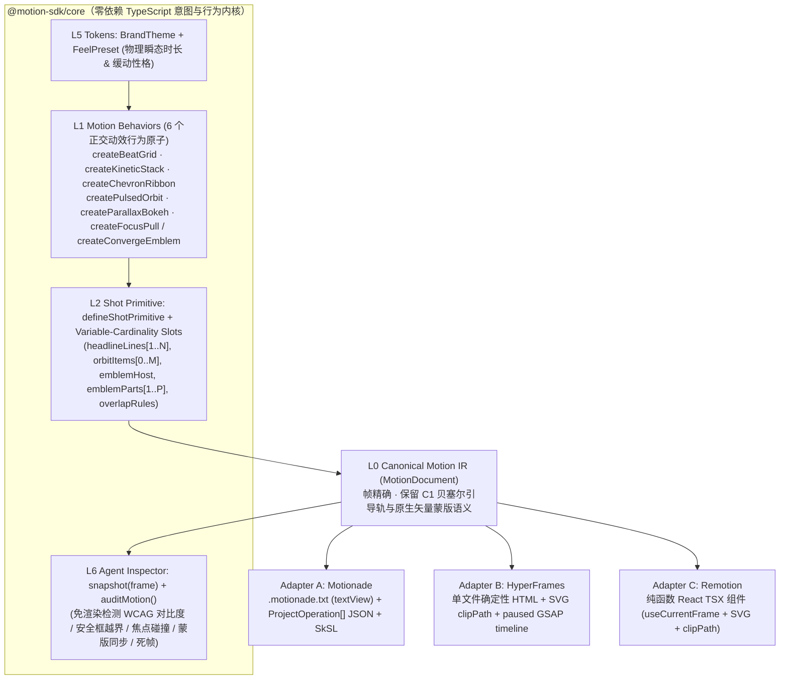

# 从 UI SDK 到 `@motion-sdk/core`：架构完整对齐与首个可复用动效原语实现

工程根目录：[/Users/zhongth/Projects/motion-sdk](..)

---

## 一、UI SDK（`vercel-labs/ui`）深度拆解：他们到底怎么设计的？

研究完 `vercel-labs/ui` 源码、内核文档与 Agent Benchmark 后，可以把它的核心设计思想浓缩为一句话：
**不要给 AI 交付封装死的成品组件（Finished Components），而是把“用来造组件库的那套底层行为积木（Behaviors）”直接作为 Public API 暴露给 AI，同时让 AI 既能无障碍“造界面”，又能免截图“读/控界面”。**

### 1. UI SDK 的七层架构与每层设计意图

| 层级 | UI SDK (`@ui-sdk/*`) 模块 | 设计意图（为什么要拆出这一层？） |
| :--- | :--- | :--- |
| **L0: Kernel（内核层）** | `foundation/kernel` (`store`, `createChange`, `elements`, Strict Role Checker) | 零框架依赖的状态机 + 可审计变更通道（每次状态变化携带 `reason`、`source: "keyboard" \| "agent"` 与 `cancel()`），并用 TypeScript 类型在编译期强制约束契约（如写了 `role: "option"` 漏写 `focus` 直接编译报错）。 |
| **L1: Behaviors（原子行为层）** | `@ui-sdk/core` 50+ `create<Thing>`（`createPopup`, `createRovingFocus`, `createSelection`, `spatialMove`…） | **最关键的一层。** 每个函数只解决**一条孤立的交互/几何/无障碍定律**（例如“一组数量未知的子元素共享 1 个 Tab 焦点并支持方向键漫游”），彻底消除 AI 手写底层 DOM 细节时的幻觉与算术错误。 |
| **L2: Primitive & Slots（原语与槽位层）** | `definePrimitive({ options, state, api, slots, agent })` | **去模板化与数量自适应的灵魂。** 原语完全不写死 DOM 树和元素个数，只声明**语义槽位（Slots）**（如 `Rating` 只有 `root` 和 `star` 槽位；传 3 颗星、5 颗星、10 颗星都由运行时动态按序收集并绑定行为）。零 CSS、零框架代码。 |
| **L3: Dogfooded Catalog（标准件目录）** | `@ui-sdk/<fw>/select`, `combobox`, `dialog` 等 50+ 组件 | 官方组件全部用 L1 + L2 自己拼出来。现成组件够用就直接引；遇到定制需求（如看板、时间轴、图标选择器），Agent 退回 L1 + L2 用完全同一套原语现场拼装，**没有能力断层（No Cliff）**。 |
| **L4: Thin Adapters（多框架投射层）** | `createParts(primitive, map)` → `react`, `vue`, `svelte`, `solid`, `web` | Adapter **薄到极致**：严禁在 Adapter 里写任何键盘逻辑、焦点转移或 ARIA，只做纯渲染投射，确保五端 Part 名称与行为 100% 同构。 |
| **L5: Tokens & State Styling（视觉解耦层）** | `data-slot` + 状态属性（`data-open`, `data-filled`）+ 几何测量 CSS 变量 + `@layer ui-sdk` | 行为层只暴露语义状态与测量值（如 `--anchor-width`），视觉皮肤完全交给外部 `--ui-*` Tokens 或 Tailwind，逻辑与审美彻底正交。 |
| **L6: Agent Bridge & Skill（Agent 闭环层）** | `createAgent` (`snapshot`, `query`, `act`) + `checkPattern` + 随包 `SKILL.md` / `llms.txt` | **免截图闭环**：Agent 不用靠昂贵的视觉截图猜状态，直接调 `snapshot()` 拿结构化语义快照，并用 `checkPattern` 做自动化规范回归（官方实测：Agent 任务 Token 从 `294k` 降到 `69.5k`，成本降约 70%）。 |

---

## 二、UI SDK → `@motion-sdk/core` 逐层精确对位

UI 领域的硬约束是 **ARIA / 焦点 / 键盘漫游 / 浮层关闭**；而在动效师脑海里，对应的硬约束（也是大模型手搓底层关键帧最容易翻车的地方）是 **节拍呼吸、构图避让、运动学曲线、景深视差、空间布尔叠色与帧确定性**。

---

## 三、首个 Motion 原子 SDK 实现明细

### 1. 六个独立的 L1 Motion Behaviors（可拆散自由重组任意新分镜）

| Behavior 模块 | 封装的动效师直觉与几何求解算法 |
| :--- | :--- |
| [beat-grid.ts](../src/behaviors/beat-grid.ts) `createBeatGrid` | **固定瞬态 + 弹性留白**：从 `3.0s@30fps` 变到 `4.5s@60fps` 时，文字滑入/失焦等物理冲击秒数保持干脆（~`0.88s`），多出的时间自动分给阅读呼吸间隔与片尾定格，绝不把动作傻傻拉慢变肉。 |
| [kinetic-stack.ts](../src/behaviors/kinetic-stack.ts) `createKineticStack` | **行数与字长自适应**：接收 `1..N` 行任意文案，自动计算不越界字号、光学垂直居中（偏上 `0.5%`）、字距收紧与节拍分发，并向外输出精确的 **`focalBounds` 保护盒**。 |
| [chevron-ribbon.ts](../src/behaviors/chevron-ribbon.ts) `createChevronRibbon` | **响应焦点的程序化 3D 折带**：读取 `focalBounds` 动态调整沙漏中心豁口 `baseHalfGap`，并在每个文字入场 Beat 上触发旋转脉冲。 |
| [pulsed-orbit.ts](../src/behaviors/pulsed-orbit.ts) `createPulsedOrbit` | **防碰撞极坐标公转场**：读取 `focalBounds` 自动外扩安全轨道半径 `safeInnerRadius`（4 行字或宽文案绝不撞字）；父环顺时针脉冲公转，子项极坐标呼吸，球体自动挂载 `worldLockedLighting` `-360°` 反向自转锁死高光方向。 |
| [parallax-bokeh.ts](../src/behaviors/parallax-bokeh.ts) `createParallaxBokeh` | **前景景深视差掠过**：根据前景体块尺寸自动赋予光学高斯模糊核，绑定 Beat 与转场前重音高速切向扫过。 |
| [converge-emblem.ts](../src/behaviors/converge-emblem.ts) `createFocusPull` & `createConvergeEmblem` | **移焦转场 + 多部件螺旋汇聚 + 声明式叠色降级**：支持任意多边形/圆角几何组合；把路径点自动解算为 C1 平滑三次贝塞尔引导轨；把 `insideHostFill` 与 `pairwiseOverlaps` 自动降级展开为严格 z-order 对齐的同步蒙版克隆层与矢量蒙版。 |

### 2. L2 分镜原语、内核质检器与三端编译器

- **分镜原语**：[statement-converge.ts](../src/primitives/statement-converge.ts)（基于 [primitive.ts](../src/kernel/primitive.ts) `defineShotPrimitive` + `slot` 定义）
- **免截图语义探针与质检器**：[inspect.ts](../src/kernel/inspect.ts)（`snapshotMotion` + `auditMotion`：自动校验 WCAG 4.5:1 对比度、安全边距、公转焦点避让、蒙版生命周期同步、无死帧）
- **三端薄编译器**：
  - Motionade 后端：[motionade.ts](../src/adapters/motionade.ts)（同时输出 `ProjectOperation[]` 与 `textView` DSL）
  - HyperFrames 后端：[hyperframes.ts](../src/adapters/hyperframes.ts)（独立可渲染 HTML + SVG `<clipPath>` + 单一 paused `gsap.timeline`）
  - Remotion 后端：[remotion.ts](../src/adapters/remotion.ts)（纯函数 React TSX 组件）
- **随包 Agent Skill**：[SKILL.md](../skills/motion-sdk/SKILL.md)

---

## 四、四组复用变体 × 三端编译实测结果

单元测试套件 [statement-converge.test.ts](../tests/statement-converge.test.ts)（含第 5 组脱离公转环的极简新原语拼装测试）与 `tsc --noEmit` 全部零错误通过；构建脚本 [build-variants.ts](../examples/build-variants.ts) 产出的四组三端文件全部 `findings = 0`：

| 变体场景 | 参数特征 | 对比度 | 质检结果 | Motionade DSL | HyperFrames HTML | Remotion TSX |
| :--- | :--- | ---: | :---: | :--- | :--- | :--- |
| **01 原版 3 行复刻** | `["Work", "differently", "with AI"]` · `3.0s@30fps` | `18.86:1` | `PASS (0)` | [01.motionade.txt](../examples/out/01-glean-3lines-3s-30fps.motionade.txt) | [01.hyperframes.html](../examples/out/01-glean-3lines-3s-30fps.hyperframes.html) | [01.remotion.tsx](../examples/out/01-glean-3lines-3s-30fps.remotion.tsx) |
| **02 自适应 2 行** | `["Think", "beyond limits"]` · 自动放大字号与呼吸窗 | `18.86:1` | `PASS (0)` | [02.motionade.txt](../examples/out/02-adaptive-2lines-3s-30fps.motionade.txt) | [02.hyperframes.html](../examples/out/02-adaptive-2lines-3s-30fps.hyperframes.html) | [02.remotion.tsx](../examples/out/02-adaptive-2lines-3s-30fps.remotion.tsx) |
| **03 自适应 4 行** | `["Orchestrate", "autonomous", "enterprise", "workflows"]` · 自动收敛字号并外扩公转轨 | `18.86:1` | `PASS (0)` | [03.motionade.txt](../examples/out/03-adaptive-4lines-3s-30fps.motionade.txt) | [03.hyperframes.html](../examples/out/03-adaptive-4lines-3s-30fps.hyperframes.html) | [03.remotion.tsx](../examples/out/03-adaptive-4lines-3s-30fps.remotion.tsx) |
| **04 换品牌 + 六边形徽标 + 60fps** | 曜石黑青珊瑚主题 + **圆角六边形宿主 × 菱形/五边形交集透镜** · `4.5s@60fps` (`270f`) | `17.45:1` | `PASS (0)` | [04.motionade.txt](../examples/out/04-veridian-rebrand-4.5s-60fps.motionade.txt) | [04.hyperframes.html](../examples/out/04-veridian-rebrand-4.5s-60fps.hyperframes.html) | [04.remotion.tsx](../examples/out/04-veridian-rebrand-4.5s-60fps.remotion.tsx) |

> [!NOTE]
> 在开发过程中，`auditMotion()` 的 `focal-clearance` 规则在零渲染状态下直接抓出了第 4 组宽文案（`"at planetary scale"`，宽 `716px`）在旧版固定半径上限下会被水平公转球体擦碰边缘的隐患；修正 `createPulsedOrbit` 的半长轴包络避让公式后，四组变体全部一次清零告警。这直接印证了仿 UI SDK `checkPattern` 语义质检器对节省视觉试错 Token 的巨大价值。
