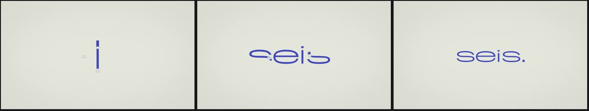
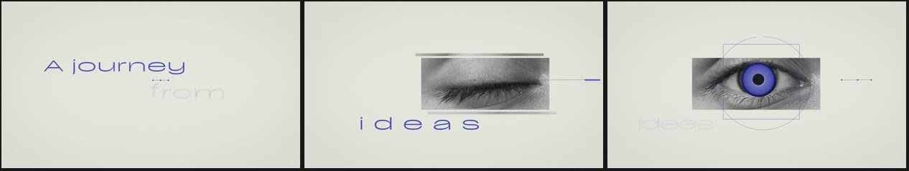
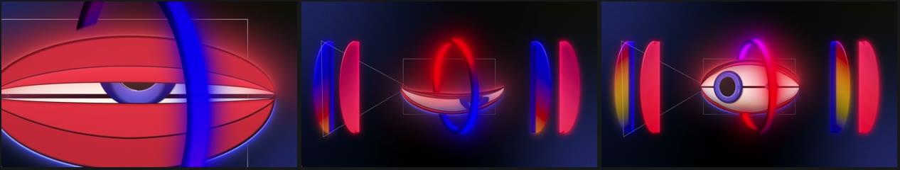
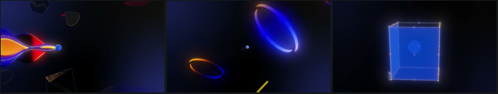
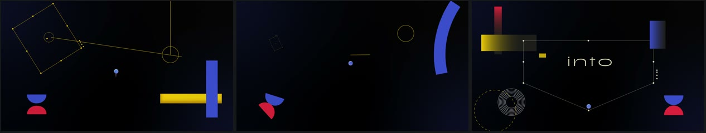
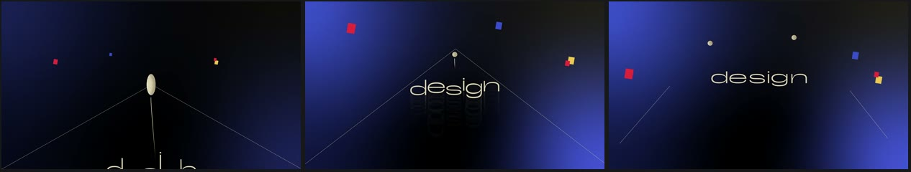
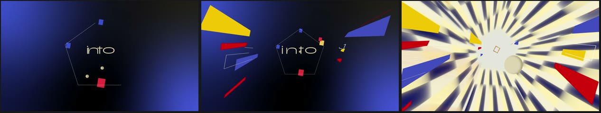
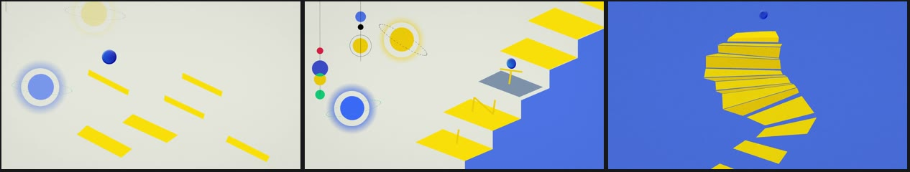
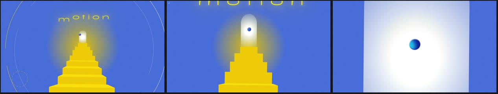
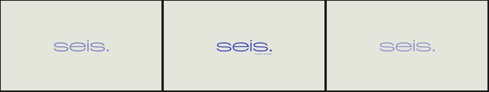

# 随机抽样实测：《Seismotion Manifiesto》全片 11 个 Motion 原子切分与 SDK 拆解

- **新工程位置**：[/Users/zhongth/Projects/motion-sdk](..)
- **随机抽中源片**：[Seismotion Manifiesto \[seismotion-manifiesto\].mp4](file:///Volumes/SamSung%20990%202TB/Motionimo/Seismotion%20Manifiesto%20%5Bseismotion-manifiesto%5D.mp4)（`1280×720` · `25 fps` · `41.76s` · `1,044 frames`）
- **切分出的 11 个独立 MP4 原子目录**：[examples/seismotion-atoms/clips](../examples/seismotion-atoms/clips)
- **机器可读切分清单**：[atoms-manifest.json](../examples/seismotion-atoms/atoms-manifest.json)

> [!IMPORTANT]
> **为什么这支随机抽中的片子是绝佳试金石？**
> 全片 41.76 秒几乎**没有任何传统硬切黑场**，全部靠图形变形、瞳孔穿透、动量接力一气呵成（叙事主线：`"seis." → "A journey from ideas" → [Eye Portal] → "into story" → "design" → "into style frames" → "motion" → "seis."`）。
> 如果用传统“镜头切点检测器”切，会完全迷失在连续转场里；但用 **Motion SDK 的“单一编排意图 + 可变槽位（Slots）+ 跨镜头动量交接（Handoff Contract）”** 来切，全片精确拆解为 **11 个边界分明、均可独立参数化复用的 L2 分镜原子**。

---

## 一、核心发现：跨片 L1 Behaviors 复用率超预期

对比我们上一个项目（Glean 3 秒企业工作流）与这次完全随机抽到的《Seismotion Manifiesto》（艺术宣言风），两者视觉风格天差地别，但拆到底层 **L1 Motion Behaviors** 时，**我们在 Glean 里写的 5 个核心 Behavior 直接命中了本片 11 个镜头中的 8 个**，全片 42 秒仅需再扩充 **7 个新 L1 Behavior** 即可 100% 覆盖：

| 类别 | L1 Behavior 名称 | 在 Glean 首个原子中的角色 | 在《Seismotion》中被复用的原子片段 |
| :---: | :--- | :--- | :--- |
| **已有复用** | `createBeatGrid` | 固定物理瞬态 + 弹性留白节拍网格 | **全部 Atom 01–11** |
| **已有复用** | `createKineticStack` | `1..N` 行标题滑入 + 字距收紧 + 输出 `focalBounds` | **Atom 02, 05, 07** |
| **已有复用** | `createPulsedOrbit` | 避让焦点盒的极坐标公转环 + 子元素呼吸 | **Atom 03（陀螺光环）, 07（五边形顶点环）, 08（四角几何挂件）** |
| **已有复用** | `createParallaxBokeh` | 前景景深大色块/碎片高速掠过 | **Atom 04（漂浮线框体）, 07（红黄蓝向心/离心几何碎片流）** |
| **已有复用** | `createRegionColorShift` | 矢量蒙版裁切与区域内外动态变色 | **Atom 02（眼部矩形窗裁切 + 蓝瞳局部着色）, 08（画框内容裁切）** |
| **新增原子** | `createStrokeTrimReveal` | — | **Atom 01（竖线分裂绘出字标）, 05（CAD 蓝图框线）, 10（波纹环）** |
| **新增原子** | `createPortalZoomHandoff` | — | **Atom 02→03（瞳孔穿透）, 07→08（隧道穿透）, 10→11（白光穿透）** |
| **新增原子** | `createTrailFollow` | — | **Atom 04（蓝球沿贝塞尔轨飞行 + 动态流体火焰拖尾）** |
| **新增原子** | `createEchoCascade` | — | **Atom 06（`"design"` 沿纵轴生成 `N` 层相位残影并向上收束合一）** |
| **新增原子** | `createZStackCarousel` | — | **Atom 08（`1..N` 张画框在 2.5D 纵深环上按节拍轮播切焦点）** |
| **新增原子** | `createSteppedBouncePath` | — | **Atom 09（球体沿 `1..N` 级等轴测台阶抛物线弹跳 + 阶梯螺旋扭转）** |
| **新增原子** | `createArcTextTrack` | — | **Atom 10（文字沿圆弧路径排布并随发光脉冲张开字距）** |

---

## 二、全片 11 个 Motion 原子逐镜切分（含分镜三联图 & 独立 MP4）

每张分镜条从左至右依次为该原子的 **`入场态 (15%) → 叙事峰值态 (52%) → 离场交接态 (88%)`**，点击每个标题旁的文件链接可直接播放切好的帧精确 `.mp4` 片段。

---

### Atom 01 · 轴线分裂描边字标揭示（`stroke-wordmark-reveal`）
- **时间 / 帧区间**：`0.00s – 3.36s`（`f000 – f084`，共 `84` 帧） · 🎬 [atom-01-stroke-wordmark.mp4](../examples/seismotion-atoms/clips/atom-01-stroke-wordmark.mp4)
- **动效师意图**：用一根贯穿上下画幅的垂直基准线向中心收缩定出视觉锚点 `i`，再向左右生长描边绘出 `"seis."`，最后拉高竖笔为下一镜腾出上方空间。
- **可变槽位（Slots）**：`glyphPaths[1..N]`（任意 SVG 字标或图形路径集合）、`originStemIndex`（充当中心起笔轴的笔画索引）。
- **L1 Behaviors**：`createBeatGrid` + `createStrokeTrimReveal`
- **离场交接（Exit Handoff）**：中心文字下沉淡化，将视线引向左上象限起笔位。

---

### Atom 02 · 标尺引导短语 → 蒙版视窗揭示（`editorial-mask-window`）
- **时间 / 帧区间**：`3.36s – 6.72s`（`f084 – f168`，共 `84` 帧） · 🎬 [atom-02-editorial-mask-window.mp4](../examples/seismotion-atoms/clips/atom-02-editorial-mask-window.mp4)
- **动效师意图**：`"A journey / from"` 沿水平细标尺错位滑入，标尺向右扫掠推开一个矩形照片蒙版窗（眨眼特写 + `"ideas"`），黑白虹膜瞬间点亮为高饱和品牌蓝并锁定几何准星。
- **可变槽位（Slots）**：`leadLines[1..N]`（传 1–4 行引导文案均可自适应排版）、`windowMedia`（任意图片/视频/UI 卡片）、`captionText`（窗下关键词）、`focusTargetCircle`（窗内高光锚点）。
- **L1 Behaviors**：`createKineticStack` `[复用]` + `createStrokeTrimReveal` + `createRegionColorShift` `[复用]`
- **离场交接（Exit Handoff）**：`scale-portal` —— 中心 `(640, 360)` 蓝色圆环指数级放大吞没全屏，无缝切入 Atom 03。

---

### Atom 03 · 瞳孔穿透 → 陀螺仪多环门阵列（`portal-gyro-rings`）
- **时间 / 帧区间**：`6.72s – 10.48s`（`f168 – f262`，共 `94` 帧） · 🎬 [atom-03-portal-gyro-rings.mp4](../examples/seismotion-atoms/clips/atom-03-portal-gyro-rings.mp4)
- **动效师意图**：承接上一镜放大的蓝瞳，镜头拉远揭示风格化红蓝几何眼球，外围展开多层 2.5D 偏轴旋转发光圆环与左右对称切片门；收尾时中心蓝瞳脱眶而出，向右加速穿过右侧环门。
- **可变槽位（Slots）**：`coreEmblem`（中心主体图形）、`gyroRings[1..M]`（任意圈数的偏轴光环）、`sideSlices[0..K]`（两侧对称折射条）、`projectile`（发射出的核心粒子）。
- **L1 Behaviors**：`createPortalZoomHandoff` + `createPulsedOrbit` `[复用]`
- **离场交接（Exit Handoff）**：`edge-velocity` —— 蓝球以高速水平向右动量 `+vx` 射出画面右边缘（`y ≈ 360`）。

---

### Atom 04 · 彗星拖尾穿环 → 线框立方体锁定（`trail-orb-gates`）
- **时间 / 帧区间**：`10.48s – 15.20s`（`f262 – f380`，共 `118` 帧） · 🎬 [atom-04-trail-orb-gates.mp4](../examples/seismotion-atoms/clips/atom-04-trail-orb-gates.mp4)
- **动效师意图**：完美接住上一镜右出的水平动量，蓝球从左边缘拖着红黄蓝流体火焰尾迹射入，连续穿过 `1..N` 个倾斜发光圆环门，最后急停收束进一个旋转的 3D 线框立方体中。
- **可变槽位（Slots）**：`heroOrb`、`gateRings[1..N]`（穿过几个里程碑环门完全弹性可配）、`terminalContainer`（终点捕获框）。
- **L1 Behaviors**：`createTrailFollow` + `createParallaxBokeh` `[复用]` + `createBeatGrid` `[复用]`
- **离场交接（Exit Handoff）**：3D 线框立方体展开降维成 2D 黄色工程参考线框。

---

### Atom 05 · Bauhaus 蓝图线框构图与词义演化（`blueprint-hud-morph`）
- **时间 / 帧区间**：`15.20s – 18.88s`（`f380 – f472`，共 `92` 帧） · 🎬 [atom-05-blueprint-hud-morph.mp4](../examples/seismotion-atoms/clips/atom-05-blueprint-hud-morph.mp4)
- **动效师意图**：在暗色画布上用 CAD 测量点线围出安全构图框，四周配平红黄蓝包豪斯几何平衡块（十字梁、半圆沙漏、同心圆靶），中心先浮现衬线体 `"story"`，再经垂直蓝光切变演化为几何体 `"into"`。
- **可变槽位（Slots）**：`wordSequence[1..N]`（框内依次切换的关键词序列）、`balanceProps[0..M]`（外围避让 `focalBounds` 的几何配重块）。
- **L1 Behaviors**：`createKineticStack` `[复用]` + `createStrokeTrimReveal` + `createPulsedOrbit`（静态构图避让变体）`[复用]`
- **离场交接（Exit Handoff）**：`vertical-impulse` —— 中心蓝色胶囊沿 `x = 640` 垂直向上高速弹射出画（`-vy`）。

---

### Atom 06 · 顶点重锤与纵向叠影收束（`echo-cascade-settle`）
- **时间 / 帧区间**：`18.88s – 20.48s`（`f472 – f512`，共 `40` 帧） · 🎬 [atom-06-echo-cascade-settle.mp4](../examples/seismotion-atoms/clips/atom-06-echo-cascade-settle.mp4)
- **动效师意图**：极短促有力的重音镜头（1.6s）——承接向上的垂直动量，白色圆球减速悬停在透视金字塔线框顶点，下方 `"design"` 带多层纵向拉伸残影（Echo Stack）向上层叠收束成清晰的一行字。
- **可变槽位（Slots）**：`headlineLines[1..N]`、`echoCopies`（残影层数参数，如 5 层或 8 层）、`apexAnchor`（顶点悬停物）。
- **L1 Behaviors**：`createEchoCascade` + `createBeatGrid` `[复用]`
- **离场交接（Exit Handoff）**：`"design"` 向中心水平坍缩，外围散点向内聚拢成五边形顶点。

---

### Atom 07 · 多边形顶点锁框 + 放射碎片超空间隧道（`polygon-radial-tunnel`）
- **时间 / 帧区间**：`20.48s – 24.00s`（`f512 – f600`，共 `88` 帧） · 🎬 [atom-07-polygon-radial-tunnel.mp4](../examples/seismotion-atoms/clips/atom-07-polygon-radial-tunnel.mp4)
- **动效师意图**：5 个彩色小方块锁住正五边形顶点框住 `"into"`，四周红黄蓝锐角碎片沿径向透视飞掠；随后正五边形猛烈旋转放大冲破镜头，展开高能放射速度线隧道。
- **可变槽位（Slots）**：`centerWord`、`polygonSides`（3/4/5/6 边形均可自动生成顶点挂件）、`radialShards[0..K]`（四周透视飞掠碎片槽位）。
- **L1 Behaviors**：`createKineticStack` `[复用]` + `createPulsedOrbit` `[复用]` + `createParallaxBokeh` `[复用]` + `createPortalZoomHandoff`
- **离场交接（Exit Handoff）**：`radial-tunnel-wipe` —— 放射条纹从中心向四周退散，将深蓝暗场翻转为暖米白画廊场。

---

### Atom 08 · 节拍驱动 2.5D 画框轮播阵列（`zstack-card-carousel`）
- **时间 / 帧区间**：`24.00s – 29.60s`（`f600 – f740`，共 `140` 帧） · 🎬 [atom-08-zstack-card-carousel.mp4](../examples/seismotion-atoms/clips/atom-08-zstack-card-carousel.mp4)
- **动效师意图**：从单个古典金框包豪斯拼贴展开为 `"style frames"` 2.5D 环形画廊，伴随密集鼓点在前景焦点位快速切换 6 种截然不同的视觉风格画框，四角辅以包豪斯几何挂件稳住构图。**这是产品宣发视频里展示多张 UI 截图 / 模板库最经典的黄金原语！**
- **可变槽位（Slots）**：`cards[1..N]`（**完全不限张数**：传 3 张产品 UI、6 张海报或 10 张卡片，Z 轴环形排布与节拍步进全部自动重算！）、`cornerBadges[0..4]`、`sectionLabel`。
- **L1 Behaviors**：`createZStackCarousel` + `createRegionColorShift` `[复用]` + `createBeatGrid` `[复用]`
- **离场交接（Exit Handoff）**：`silhouette-collapse` —— 全部画框瞬间染成纯黄剪影并压扁收拢成阶梯积木。

---

### Atom 09 · 等轴测拾级弹跳 → 3D 阶梯螺旋重构（`isometric-step-spiral`）
- **时间 / 帧区间**：`29.60s – 33.80s`（`f740 – f845`，共 `105` 帧） · 🎬 [atom-09-isometric-step-spiral.mp4](../examples/seismotion-atoms/clips/atom-09-isometric-step-spiral.mp4)
- **动效师意图**：黄色积木展开为斜向分割画面的等轴测阶梯，蓝球按节拍逐级弹跳向上（每踩一级触发一次颜色/阴影反馈）；登顶瞬间背景全蓝，整条阶梯在空间中螺旋扭转堆叠成中心对称金字塔。
- **可变槽位（Slots）**：`steps[2..N]`（传 4 步工作流或 7 步成长阶梯，台阶排布与抛物线落点自动按 `N` 求解）、`climberOrb`、`ambientMobiles[0..K]`。
- **L1 Behaviors**：`createSteppedBouncePath` + `createBeatGrid` `[复用]`
- **离场交接（Exit Handoff）**：螺旋阶梯正面锁死成对称阶梯金字塔底座，蓝球抵达塔尖。

---

### Atom 10 · 塔尖灯塔升腾与弧形字距张开（`beacon-arc-ascend`）
- **时间 / 帧区间**：`33.80s – 37.00s`（`f845 – f925`，共 `80` 帧） · 🎬 [atom-10-beacon-arc-ascend.mp4](../examples/seismotion-atoms/clips/atom-10-beacon-arc-ascend.mp4)
- **动效师意图**：全片情绪最高潮——塔尖点亮暖黄辉光胶囊并向外扩散多层细线声波圆环，上方 `"m o t i o n"` 沿圆弧优雅张开字距；随后镜头推入白色发光胶囊核心，蓝球缩作一点融化在纯白柔光中。
- **可变槽位（Slots）**：`pedestal`（底座图形）、`beaconCore`、`arcTitle`（任意高潮关键词）、`rippleCount`（波纹圈数）。
- **L1 Behaviors**：`createArcTextTrack` + `createStrokeTrimReveal` + `createPortalZoomHandoff`
- **离场交接（Exit Handoff）**：高光满溢平滑过渡回与片头完全一致的 `#EBE9E1` 暖灰米白底色。

---

### Atom 11 · 纯白落定与首尾闭环品牌收尾（`minimal-loop-resolve`）
- **时间 / 帧区间**：`37.00s – 41.76s`（`f925 – f1044`，共 `119` 帧） · 🎬 [atom-11-minimal-loop-resolve.mp4](../examples/seismotion-atoms/clips/atom-11-minimal-loop-resolve.mp4)
- **动效师意图**：喧嚣过后极简留白——在呼吸感十足的纯净底色上柔和浮现 `"seis."` 与副标，定格阅读后轻柔淡出，使第 `1044` 帧与第 `0` 帧无缝首尾循环。
- **可变槽位（Slots）**：`brandMark`、`tagline`（可选副标）、`holdSec`（片尾定格时长）。
- **L1 Behaviors**：`createBeatGrid` `[复用]` + `createKineticStack`（极简呼吸淡入变体）`[复用]`

---

## 三、这次随机实验给 `@motion-sdk/core` 带来的关键架构印证

1. **证明了“Motion 原子 ≠ 视频模板”**：这 11 个片段里，没有任何一个是只能换文字的死板模板——`Atom 02` 的引导行数、`Atom 04` 的穿环个数、`Atom 06` 的叠影层数、`Atom 07` 的多边形边数与碎片流、`Atom 08` 的轮播画框张数、`Atom 09` 的台阶步数，全部天然对应 **`defineShotPrimitive` 的可变基数 `slot("collection")`**。
2. **发现了比 UI SDK 多出的关键一环：`Handoff Contract`（镜头交接协议）**：
   UI 组件之间靠 Layout 容器拼在一起；而多个 Motion 原子拼成一支完整成片时，靠的是前一个原子 `exitHandoff` 与后一个原子 `entryHandoff` 的**空间位置、速度方向与主导色彩对齐**（如 `scale-portal`、`edge-velocity`、`vertical-impulse`、`radial-tunnel-wipe`）。把 `handoff` 加进 `defineShotPrimitive` 的一等公民定义里，AI Agent 就能像拼乐高一样把任意几个分镜原语串成丝滑的一镜到底大片！
